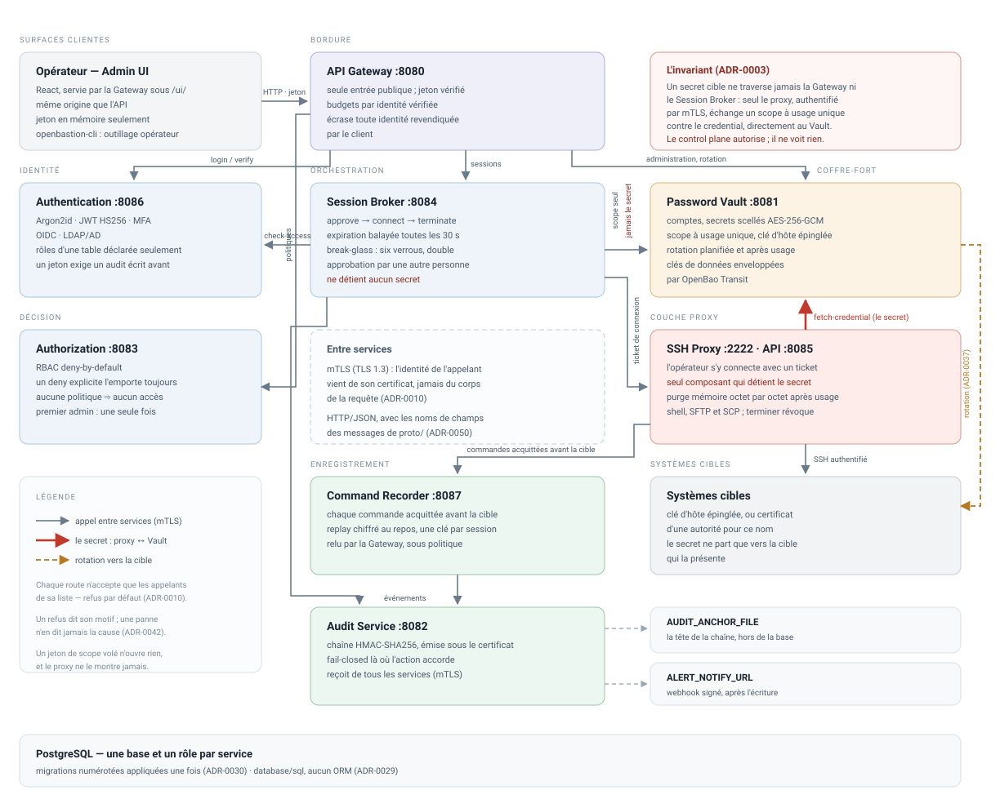

# OpenBastion

Plateforme PAM (Privileged Access Management) open source, cloud-native, écrite en Go. Licence AGPL-3.0.

> **État du projet** : implémentation du MVP en cours. Ce dépôt contient actuellement le premier incrément vertical — la partie du système qui prouve l'invariant de sécurité fondateur — pas encore l'ensemble des services du périmètre MVP. Le parcours SSH/SFTP/SCP constitue le périmètre MVP fonctionnel. Des travaux avancés sur le proxy RDP/VNC sont en cours, mais le runtime RDP reste désactivé et ne doit pas être présenté comme une fonctionnalité disponible. Voir [la feuille de route](docs/roadmap.md) et les [limites connues](docs/security/known-limitations.md).



L'opérateur n'a jamais le mot de passe de la cible. Il demande une session à la Gateway, le Session Broker l'autorise puis le câble à un proxy protocolaire ; **seul ce proxy** échange un scope à usage unique contre le credential, directement auprès du Vault, s'en sert pour joindre la cible et le purge ensuite. Chaque commande est acquittée avant d'atteindre la cible, chaque geste rejoint une chaîne d'audit à clé ancrée hors de la base, et la rotation du secret se fait sur la cible elle-même.

Le MVP couvre ce parcours de bout en bout pour SSH, SFTP et SCP. Le travail RDP/VNC suit une voie séparée et incrémentale : le parcours VNC a été validé de bout en bout avec TigerVNC 1.13.1 ; le moteur RDP Go pur couvre déjà plusieurs phases du protocole et certains profils graphiques, mais son runtime est encore désactivé, sa couverture graphique reste partielle et aucune interopérabilité Windows/RDS réelle n'est encore démontrée. Consultez `docs/security/known-limitations.md` avant toute évaluation. Les propriétés que le code ne doit jamais perdre — et l'endroit exact où chacune est tenue — sont dans [`.agents/architecture/invariants.md`](.agents/architecture/invariants.md).

## Démarrage rapide

Prérequis : Go ≥ 1.22. Le transport interne est en mTLS par défaut (ADR-0010) : `make pki` crée d'abord les identités des services dans `.pki/`, ou `INTERNAL_TLS=disabled` lance sans certificats (développement uniquement).

```sh
make build             # compile tous les modules implémentés
make vet               # go vet sur l'ensemble
make test              # tests unitaires (hermétique, sans PostgreSQL)
make test-integration  # tests de bout en bout, inter-processus réel
make test-postgres     # tests PostgreSQL réels (TEST_DATABASE_URL requis)
```

Lancer les services individuellement (dans des terminaux séparés, dans cet ordre ; `make pki` avant, ou `INTERNAL_TLS=disabled` à la suite de chaque commande) :

```sh
make pki                  # une fois : autorité de développement + identité de chaque service
make run-vault            # :8081
make run-audit            # :8082
make run-authorization    # :8083
make run-authentication   # :8086
make run-ssh-proxy        # :2222 (SSH réel) + :8085 (API interne)
make run-broker           # :8084 — appelle Authorization/Vault/Audit/ssh-proxy
make run-gateway          # :8080 — point d'entrée public unique
```

## Une remarque avant de lire le code

Le transport entre services est HTTP/JSON sous mTLS, avec les noms de champs des messages de `proto/` (`docs/api/grpc/README.md`) : d'abord une contrainte du réseau de construction, c'est depuis ADR-0050 une décision, et `test/integration/contract_test.go` empêche les routes de diverger de leurs messages sans le dire. gRPC reviendrait avec un flux réel, des clients dans un autre langage, ou une mesure de performance.

## Structure

Voir `docs/development/repository-structure.md` pour l'arborescence cible complète (~35 microservices). Ce qui existe aujourd'hui :

```
pkg/proxycore/                                   pipeline proxy partagé (ADR-0006)
pkg/mtls/                                        identité par certificat, garde d'appelants, rotation, PKI de dev (ADR-0010)
services/access/authorization/                   décision RBAC (deny-by-default)
services/access/session-broker/                  orchestrateur de session
services/proxy/ssh-proxy/                        premier proxy protocolaire réel (SSH)
services/vault/password-vault/                   coffre-fort (comptes, secrets, scopes)
services/recording-audit/audit-service/          audit à chaînage de hash
services/recording-audit/command-recorder/       replay texte des sessions (commandes horodatées)
test/integration/                                preuve inter-processus de l'invariant
proto/                                            contrats gRPC/Protobuf (`docs/api/grpc/README.md`)
docs/                                             architecture, ADR et guides
```

## Documentation

Toute la documentation vit sous `docs/`, une section par public : architecture, ADR, API, sécurité, développement, déploiement, administration, guide utilisateur. Le plan, et la correspondance avec les anciens documents numérotés, sont dans [`docs/README.md`](docs/README.md).

## Licence

AGPL-3.0 — voir [`LICENSE`](LICENSE).
