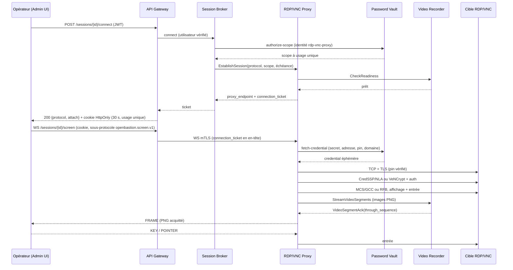

# ADR-0072 — Le proxy RDP/VNC termine la cible en Go pur et sert un flux écran acquitté

**Statut** `Proposé` · 2 novembre 2026 · s'il est accepté, remplace ADR-0071 et amende ADR-0069 (règles 1, 2 et 6)

> Proposition demandée par le propriétaire du projet « sans tenir compte d'ADR-0071 ». Le dépôt applique « concevoir avant de coder » : aucun code de proxy RDP/VNC n'est écrit tant que cet ADR n'est pas accepté.

## Contexte

ADR-0069 (accepté) fixe les garanties du proxy RDP : terminaison côté cible, NLA/CredSSP obligatoire, empreinte du certificat TLS de la cible vérifiée **avant** l'envoi du mot de passe Vault, enregistrement vidéo obligatoire, canaux secondaires fermés, révocation et expiration réelles. ADR-0070 (accepté) livre le Video Recorder et son contrat de segments acquittés. ADR-0071 (accepté) choisit FreeRDP par cgo comme moteur ; la présente proposition l'écarte.

Trois constats, vérifiés dans le dépôt, rendent une autre conception nécessaire.

1. **La feuille de route demande RDP *et* VNC** (`docs/roadmap.md`, v0.0.1). ADR-0069 laisse VNC hors de son périmètre et exige une décision propre ; aucune décision ne couvre aujourd'hui VNC.
2. **cgo contredit le mode de livraison actuel.** ADR-0033 déploie des images statiques ; ADR-0071 reconnaît lui-même que « l'image distroless statique actuelle ne suffit pas sans évolution », qu'il faut un compilateur C, les en-têtes FreeRDP, des bibliothèques natives à l'exécution, et que `-race` ne couvre pas une surface native. Ce sont exactement les coûts que le dépôt évite ailleurs.
3. **Le côté opérateur d'ADR-0071 ne sert aucun client disponible.** ADR-0071 exige l'API *peer serveur* de FreeRDP pour terminer RDP côté opérateur ; or l'Admin UI est un navigateur (ADR-0036) et le Desktop Client (Tauri) est sur la feuille de route. Il faudrait de toute façon un client RDP WASM ou desktop, explicitement hors périmètre d'ADR-0069 et d'ADR-0071.

État réel du code au 2 novembre 2026 :

- `pkg/rdp` ne contient que deux primitives Go (empreinte SHA-256 d'un DER, vérification d'une chaîne PEM) et un test derrière `//go:build freerdp && cgo` ; **aucun moteur, aucun service**.
- `pkg/mtls` réserve l'identité `rdp-proxy` ; le Video Recorder l'autorise sur `StreamVideoSegments` et `CheckReadiness`, mais aucun service ne la présente.
- `application.ProxySelector.Select` ne connaît que `ssh` ; `pkg/proxycore.Codec` est un relais `io.ReadWriter` (pertinent pour SSH, pas pour un flux graphique).
- `POST /sessions/{id}/connect` renvoie `proxyEndpoint`, `ticket`, `expiresAt` ; le ticket est consommé une fois par le proxy.
- ADR-0070 borne une image à 16 777 216 pixels et 4 Mio, un segment à 250 ms ou 4 Mio, et exige l'acquittement avant tout envoi à l'opérateur.

Invariants touchés : ADR-0003 (le secret reste dans le proxy), ADR-0008 (enregistrer ou refuser), ADR-0009 (break-glass), ADR-0010 (identité mTLS), ADR-0018 (terminer, c'est couper), ADR-0039 (reconnaître la cible avant le secret), ADR-0042 (codes de refus), ADR-0050 (transport), ADR-0070 (segments acquittés).

## Décision

### 1. Un service, deux moteurs Go purs, aucun natif

`services/proxy/rdp-vnc-proxy` sert les comptes Vault de protocole `rdp` et `vnc`. Son identité mTLS est `rdp-vnc-proxy` : la constante réservée `mtls.RDPProxy = "rdp-proxy"` est renommée `RDPVNCProxy = "rdp-vnc-proxy"` et les listes d'appelants du Video Recorder suivent (aucun service déployé ne présente l'ancienne identité). L'image reste statique et distroless : **aucun cgo, aucune bibliothèque native, aucun sous-processus**.

Le moteur est choisi par le **protocole du compte**, transmis par le Broker, jamais par le client. Le proxy refuse un protocole qu'il ne sert pas (`409`).

### 2. Le côté cible est un client de protocole écrit dans le dépôt

- `pkg/rdp` : sous-ensemble **client** RDP (X.224 + négociation, TLS, CredSSP/NLA NTLMv2, MCS/GCC, capacités, Client Info, bitmap updates, ordres de base et cache de glyphes, entrée, trame).
- `pkg/vnc` : client RFB 3.8 (négociation, VeNCrypt/X.509, auth, encodages, framebuffer, entrée).
- `pkg/tlspin` : les primitives d'épinglage TLS actuelles de `pkg/rdp` y sont déplacées et partagées par les deux moteurs.

Aucun code de client RDP/VNC tiers n'est importé, copié ni lié. Seules la bibliothèque standard et `golang.org/x/crypto` sont utilisées (MD4 pour NTLMv2). Les fichiers FreeRDP de `pkg/rdp` (`freerdp_native_test.go` et tout binding cgo) restent tant qu'ADR-0071 est en vigueur ; ils sont retirés avec lui.

Le côté aval d'ADR-0071 (RDP *serveur* vers l'opérateur) **n'existe pas** dans cette proposition : voir la décision 4.

### 3. RDP vers la cible : sous-ensemble strict, refus par défaut

La connexion cible est un client RDP qui n'accepte que ce sous-ensemble. Tout le reste est refusé, jamais dégradé.

| Couche | Accepté | Refusé (fermé) |
|---|---|---|
| Transport | TCP vers `host:port` du compte, X.224 + RDP Negotiation | port implicite, cible différente du credential |
| Sécurité négociée | `PROTOCOL_HYBRID` (TLS + CredSSP) | `PROTOCOL_RDP` (sécurité standard), `PROTOCOL_SSL` seul, `PROTOCOL_RDSTLS` |
| TLS | TLS ≥ 1.2, **pin SHA-256 de la feuille** | chaîne système, nom DNS/CN, confiance au premier usage |
| Authentification | CredSSP/NLA, NTLMv2, domaine optionnel (vide = compte local) | NTLMv1, LM, mot de passe du client, repli sans NLA |
| MCS/GCC | canal d'E/S et canal utilisateur, **zéro canal virtuel** | `cliprdr`, `rdpdr`, `rdpsnd`, `drdynvc`, `rdpecam`, tout canal virtuel |
| Capacités | 32 bpp, bitmap RAW + RLE (RDP6), ordres de base, cache bitmap borné (v2/v3), cache de glyphes | RemoteFX, EGFX, NSCodec, cache hors écran, multi-moniteurs |
| Ordres | DstBlt, PatBlt, ScrBlt, MemBlt, Mem3Blt, LineTo, OpaqueRect, SaveBitmap, GlyphIndex, FastIndex, MultiDstBlt, MultiPatBlt, MultiScrBlt, MultiOpaqueRect | tout ordre non annoncé : la session est refusée |
| Entrée | `TS_INPUT_PDU` (scancodes, souris) | fastpath input et Unicode input dans le premier incrément |
| Affichage | un moniteur, redimensionnement borné | multi-moniteurs, bureau au-delà de 16 777 216 px |
| Fin | MCS Disconnect Provider Ultimatum, TLS `close_notify` | — |

Le certificat TLS de la cible est vérifié dans `tls.Config.VerifyConnection` **avant** le premier octet CredSSP ; une empreinte absente, mal formée ou différente ferme la connexion et écrit `session.tls_certificate_mismatch` à l'audit. Le pin est la seule ancre : une redirection DNS ne suffit pas à usurper la cible, puisque l'imposteur ne peut pas présenter le certificat épinglé.

**Dérogation de policy, explicite.** Vérifier un certificat par empreinte impose `InsecureSkipVerify: true` avec `VerifyConnection`, ce que `.agents/policies/cryptography.md` §1 interdit sans accord nommé. La proposition demande cette levée pour **un seul constructeur** (`tlspin.ServerConfig(pin)`), qui refuse une empreinte absente et ne sert qu'au dialogue TLS de la cible. Aucun autre `tls.Config` du dépôt n'est concerné ; le dialogue interne reste en TLS 1.3 mutuel. Sans ce go, l'implémentation s'arrête.

### 4. Le côté opérateur n'est ni RDP ni VNC : un flux écran unique

Ce point **amende la règle 2 d'ADR-0069 pour le seul segment aval**. Le segment cible conserve toutes ses garanties : NLA, pin avant secret, enregistrement obligatoire, canaux secondaires fermés, révocation, expiration.

L'opérateur reçoit un **flux binaire en WebSocket**, servi par l'API Gateway sur l'origine unique de l'Admin UI. Le flux transporte :

- des images **PNG complètes**, exactement les octets que le Video Recorder a acquittés (ADR-0070), avec séquence et horodatage UTC ;
- les événements d'entrée normalisés (clavier, souris), validés et bornés côté proxy.

Aucun serveur RDP/VNC, aucun client WASM, aucun client externe. Le Desktop Client pourra réutiliser le même contrat. Ce choix supprime la surface « peer serveur » d'ADR-0071 et rend l'affichage identique à l'enregistrement : ce que l'opérateur voit est, à l'octet près, ce qui est rejoué.

### 5. VNC vers la cible : VeNCrypt/X.509 seulement

- RFB **3.8** uniquement (`RFB 003.008`) ; 3.3 et 3.7 sont refusés.
- Sécurité : **VeNCrypt 0.2**, sous-types **X509Vnc (261)** et **X509Plain (262)**, TLS ≥ 1.2 et même pin SHA-256 de la feuille. `None` (1), `VNC Authentication` (2) sans TLS, `TLS` (18) seul, RA2/RA2ne/Tight/Ultra sont refusés.
- `X509Plain` (nom d'utilisateur + mot de passe dans TLS) est préféré ; `X509Vnc` n'est accepté que si le mot de passe Vault fait **au plus 8 octets** — un mot de passe plus long serait tronqué en silence par l'authentification VNC historique, ce qui affaiblit le secret : il est refusé.
- Format pixel : true colour 32 bpp uniquement (`SetPixelFormat` si le serveur annonce autre chose).
- Encodages demandés : Raw, CopyRect, DesktopSize, ExtendedDesktopSize, Cursor, LastRect. Tight, ZRLE, Zlib, Hextile, JPEG et H.264 sont refusés.
- `ServerCutText` et `Bell` sont ignorés ; aucun `ClientCutText` n'est envoyé (presse-papiers fermé).
- Un seul écran ; ExtendedDesktopSize à plusieurs moniteurs est refusé. Bornes : 16 777 216 px, framebuffer 64 Mio (16 777 216 × 4 octets), rectangle d'update dans les bornes.

### 6. Le flux écran : contrat binaire, versionné, borné

Une seule version (`openbastion.screen.v1`). Trame serveur → client :

| Octet | Champ | Valeur |
|---|---|---|
| 0 | version | `1` |
| 1 | type | `1` FRAME, `2` HELLO, `3` END |
| 2–3 | drapeaux | `0` |
| 4–11 | séquence | `uint64`, croissante, à partir de 1 |
| 12–19 | horodatage | `int64` Unix nanosecondes, UTC |
| 20–23 | largeur | `uint32` |
| 24–27 | hauteur | `uint32` |
| 28–31 | longueur PNG | `uint32`, ≤ 4 194 304 |
| 32… | PNG | octets acquittés par le recorder |

`HELLO` porte en plus le protocole (`u8` : `1` RDP, `2` VNC), un octet réservé, l'échéance de session (`u64`, Unix), la longueur de l'identifiant (`u32`) et l'identifiant de session. `END` porte un code stable (`u16`, voir §12), la longueur du texte (`u16`) et un texte UTF-8 de 200 octets au plus, jamais une cause interne.

Entrée client → serveur, message fixe de 16 octets : version, type (`1` KEY, `2` POINTER, `3` RELEASE_ALL), drapeaux (`KEY` : appui/relâchement), `keysym` X11, scancode PS/2 set 1, coordonnées, boutons, molette. Tout message de plus de 64 octets, tout type inconnu, toute coordonnée hors trame, tout bouton hors masque, toute touche hors table **ferme la session** — l'entrée n'est jamais interprétée « au mieux ».

Le client envoie `RELEASE_ALL` quand il perd le focus (pas de touche collée). L'entrée n'est **jamais journalisée ni enregistrée** (ADR-0069, règle 6) ; seules les erreurs de validation sans contenu sont tracées.

Un débit d'entrée par session est proposé (`SCREEN_INPUT_RATE_PER_SECOND=200`, `SCREEN_INPUT_BURST=400`) ; les déplacements de souris au-delà sont coalescés, un flux de touches au-delà ferme la session.

### 7. Le rattachement est à usage unique et ne met aucun secret dans une URL

Le contrat exact qu'ADR-0069 laissait à définir :

1. `POST /sessions/{id}/connect` (route existante, budget ADR-0016) reste le seul point d'entrée. Pour `ssh`, la réponse ne change pas. Pour `rdp`/`vnc`, elle devient `{protocol, attach, expiresAt}` — `expiresAt` est celle de l'attache, l'échéance de la session est dans `HELLO` — et l'adresse interne du proxy n'est **pas** exposée au navigateur.
2. La Gateway garde en mémoire, pour 30 s au plus et une fois, le couple `{proxy_endpoint, connection_ticket}` du Broker, indexé par une valeur aléatoire de 256 bits liée à la session et à l'utilisateur vérifié. Cette valeur part dans un **cookie `HttpOnly`, `Secure`, `SameSite=Strict`**, de chemin `/sessions/{id}/screen` et de durée 30 s ; le corps de la réponse ne la porte jamais, donc elle n'est ni dans JavaScript, ni dans une URL, ni dans un journal applicatif.
3. Le navigateur ouvre `GET /sessions/{id}/screen` en WebSocket avec le sous-protocole `openbastion.screen.v1` ; le navigateur envoie le cookie. La Gateway le consomme atomiquement, ouvre un WebSocket mTLS vers le proxy et y présente le `connection_ticket` dans un en-tête `Authorization`.
4. Le proxy consomme ce ticket une fois (même registre que le proxy SSH, avec le protocole dans l'entrée), vérifie `LiveSessions` (session révoquée ⇒ refus) puis exécute le pipeline.
5. Un cookie rejoué, expiré ou inconnu est refusé ; un nouveau `connect` pour la même session invalide l'attache précédente ; une révocation jette les tickets non utilisés (ADR-0018).

Limite assumée : la table des attaches est en mémoire, donc la Gateway reste à une instance dans le MVP — comme ses budgets de débit (ADR-0014/0016). Une Gateway redémarrée demande un nouveau `connect` ; la session reste active jusqu'à son échéance.

### 8. Le Video Recorder et ADR-0070 ne changent pas

Le proxy est un nouveau client de `StreamVideoSegments` et `CheckReadiness`, sous l'identité `rdp-vnc-proxy` ; les listes d'appelants du Video Recorder sont mises à jour et ses tests avec elles. Les règles d'ADR-0070 sont reprises telles quelles : séquences à partir de 1, strictement croissantes, segment ≤ 250 ms ou 4 Mio, un seul segment en vol, acquittement après persistance durable, marqueur terminal, aucun tampon local, `session.recording_lost` sinon.

Le proxy clôt un segment à l'intervalle de capture (`SCREEN_FRAME_INTERVAL_MS=50`, borné à [16, 250]) ou à la borne de 4 Mio, et n'envoie à l'opérateur que les images **acquittées**. Une image PNG de plus de 4 Mio ou un dépassement de la borne de pixels ferme la session et écrit `session.recording_lost` — ADR-0070 ne permet ni troncature ni `best-effort`.

Aucune dérogation break-glass pour les écrans : ADR-0069 règle 5 l'interdit. Le proxy n'appelle que `Admit`, jamais `AdmitSession(breakGlass=true)` ; le Broker refuse de créer une session break-glass `rdp`/`vnc`.

### 9. Le Vault épingle le certificat TLS comme il épingle la clé d'hôte

- Migration `008_screen_targets.sql` : `tls_certificate_sha256 TEXT NOT NULL DEFAULT ''` et `target_domain TEXT NOT NULL DEFAULT ''` sur `privileged_accounts`.
- `FetchCredentialResponse` gagne, de façon additive, `string tls_certificate_sha256 = 6` et `string target_domain = 7` ; `proxycore.Credential` les porte et les purge avec le reste.
- `SetTLSPin` (RPC + `PUT /vault/accounts/{id}/tls-pin`) : empreinte SHA-256 hexadécimale de 64 caractères, refusée si vide, mal formée ou posée sur un compte `ssh`. Le changement est **audité avant d'être appliqué** (`vault.tls_pin_set`), comme l'épinglage SSH (ADR-0039) ; la réponse donne l'empreinte, jamais un secret.
- Un compte `rdp`/`vnc` sans empreinte n'ouvre aucune session : `authorize-scope` répond `409` avec le code stable `no_pinned_tls_certificate` (ADR-0042), et `connect` le traduit pour l'opérateur. Le Broker refuse aussi la **création** de la session sur un tel compte, comme ADR-0043 le fait pour la clé d'hôte : une session qui ne pourrait jamais se connecter n'est pas créée.
- `target_host` reste `host:port`, comme pour SSH ; aucun port par défaut implicite. Le pin fait foi, pas le nom DNS.

### 10. Le Broker route par protocole, la Gateway sert le rattachement

- `ProxySelector.Select` mappe `ssh → ssh-proxy`, `rdp|vnc → rdp-vnc-proxy`, tout le reste refusé.
- **Le protocole d'une session est celui du compte privilégié, pas celui du corps de la requête.** Aujourd'hui `POST /sessions` recopie la valeur fournie par le client sans la confronter au compte (`createSession`, `session_broker_service.go`) ; avec plusieurs familles de proxy, cet écart devient un routage choisi par le client. Le Broker refuse une valeur qui diffère du compte (`409`), ne route que sur la valeur du compte, et `AccountLookup` expose le protocole du compte pour le faire. Le proxy refuse de son côté tout protocole qu'il ne sert pas.
- Le Broker tient un pool par famille de proxy (`SSH_PROXY_URLS`, `RDP_VNC_PROXY_URLS`, 1 à 16 instances, ADR-0046) et appelle la famille de la session, y compris pour la révocation.
- `EstablishSessionRequest` gagne `string protocol = 8` (additif). Le proxy stocke le protocole avec le ticket ; le Broker ne l'envoie pas au moteur par le credential. La réponse interne du Broker à `connect` porte le protocole, pour que la Gateway sache quelle forme de `ConnectionTicket` rendre.
- La Gateway gagne la route WebSocket `/sessions/{id}/screen`, la table bornée des attaches et le relais WebSocket mTLS. Elle refuse une origine non déclarée (`SCREEN_ALLOWED_ORIGINS`, défaut : même origine), désactive la compression (`permessage-deflate`), borne la taille des messages, n'accepte que le binaire et borne les attaches (un par session et par utilisateur, dix upgrades par minute et par utilisateur, propositions).
- Le contrat `ConnectionTicket` d'OpenAPI gagne les champs `protocol` et `attach` ; `proxyEndpoint` et `ticket` restent pour SSH. Le cookie d'attache est posé par la Gateway, hors du corps.

### 11. Le pipeline partagé est réutilisé, pas dupliqué

`pkg/proxycore` gagne un chemin « écran » qui réutilise **exactement** le cycle de vie de `Listener.Serve` : `Live.Begin` (révocation possible), admission d'enregistrement, récupération du credential, échéance, révocation, audit, purge. Refactor minimal : la partie commune est extraite dans une fonction interne qui prend une closure de relais ; `Serve` (SSH) passe `codec.Relay`, `ServeScreen` passe le relais écran. Les tests SSH existants sont la garde de la non-régression.

Ports ajoutés (noms proposés, figés à l'implémentation) :

```go
type ScreenCodec interface {
    Open(ctx context.Context, cred *Credential) (ScreenSession, error)
}

type ScreenSession interface {
    Frames() <-chan Frame // fermée à la fin ; Err dit pourquoi
    Input(Event) error
    Err() error
    Close() error
}

type FrameRecorder interface {
    Record(ctx context.Context, sessionID string, f Frame) (throughSequence uint64, err error)
    Seal(ctx context.Context, sessionID string, throughSequence uint64) error
}

type ScreenSink interface {
    Send(ctx context.Context, msg ScreenMessage) error
}
```

Le relais écran (dans `proxycore`) : image → `Record` (bloque jusqu'à l'acquittement) → `Sink.Send` ; une seule image en attente d'affichage, remplacée par la plus récente si le client est lent (les images sont complètes ; l'enregistrement, lui, ne perd rien). Une erreur, un acquittement ambigu ou un dépassement ferme les deux côtés.

### 12. Refus : codes stables, aucune cause interne

Avant le WebSocket, `connect` répond `409`/`503` selon ADR-0042. Après le WebSocket, `END` porte l'un de ces codes : `pin_missing`, `pin_mismatch`, `tls_required`, `nla_required`, `protocol_version_unsupported`, `codec_unsupported`, `recording_unavailable`, `recording_lost`, `ticket_invalid`, `input_invalid`, `session_expired`, `session_revoked`, `target_unreachable`. Le texte est court, stable, sans adresse, sans nom interne, sans cause de panne.

### 13. Dépendances : deux ajouts, soumis à la policy

- `golang.org/x/crypto` (MD4 uniquement) dans `pkg/rdp` — déjà épinglé à `v0.58.0` dans le graphe du dépôt ; aucune nouvelle version.
- `github.com/coder/websocket` (MIT, sans dépendance, contextuel) dans la Gateway et le proxy — pour le serveur *et* le client WebSocket, plutôt qu'une implémentation RFC 6455 écrite à la main.

`.agents/policies/dependencies-and-supply-chain.md` §2 exige un accord nommé avant tout ajout : **le go demandé pour cet ADR vaut accord pour ces deux dépendances**, à leurs versions épinglées et vérifiées. À défaut, la Gateway et le proxy restent sans WebSocket et aucun incrément ne se livre.

### 14. Ce qui est refusé par principe

RDP sans NLA, TLS seul ou sécurité standard ; VNC sans VeNCrypt/X.509 ; pin absent ou différent ; recorder indisponible ou en retard d'acquittement ; break-glass pour un écran ; presse-papiers, audio, lecteurs, imprimantes, cartes à puce, caméra, multi-moniteurs ; RemoteFX/EGFX ; client RDP/VNC externe ; image > 4 Mio ou > 16 777 216 px ; tout PDU, encodage ou ordre hors du sous-ensemble annoncé ; toute session non révocable (`proxycore.LiveSessions` absent).

## Architecture et contrats

### Vue d'ensemble



### Flux de décision du moteur

| Protocole du compte | Moteur | Négociation obligatoire | Secret envoyé après |
|---|---|---|---|
| `rdp` | `pkg/rdp` | `PROTOCOL_HYBRID` | TLS + pin, puis CredSSP |
| `vnc` | `pkg/vnc` | VeNCrypt X509Vnc/X509Plain | TLS + pin, puis auth VNC/Plain |
| `ssh` | inchangé (`services/proxy/ssh-proxy`) | clé d'hôte épinglée (ADR-0039) | vérification de la clé d'hôte |

### Données et contrats

| Élément | Changement |
|---|---|
| `privileged_accounts` | `tls_certificate_sha256`, `target_domain` (migration 008) |
| `proto/vault/v1` | `FetchCredentialResponse` champs 6 et 7 ; `SetTLSPin` ; `PrivilegedAccount.tls_certificate_fingerprint` |
| `proto/proxy/v1` | `EstablishSessionRequest.protocol = 8` |
| `docs/api/rest/openapi.yaml` | `ConnectionTicket` étendu (`protocol`, `attach`), en-tête `Set-Cookie` de l'attache ; `PUT /vault/accounts/{id}/tls-pin` ; codes de refus |
| Audit | `session.tls_certificate_mismatch` (proxy), `vault.tls_pin_set` (Vault), plus les événements existants |
| Identités mTLS | `rdp-vnc-proxy` (remplace la constante réservée `rdp-proxy`) |
| Ports | proxy 8090 (contrôle + WebSocket, mTLS) ; la Gateway reste 8080 ; le SSH proxy reste 8085/2222 |

### Configuration proposée

| Variable | Défaut | Rôle |
|---|---|---|
| `VIDEO_RECORDER_URL` | aucune | obligatoire sous `RECORDING_POLICY=required` (défaut) |
| `RECORDING_POLICY` | `required` | inchangé ; `best-effort` est refusé pour les écrans |
| `SCREEN_FRAME_INTERVAL_MS` | `50` | clôture d'un segment ; borné à [16, 250] |
| `SCREEN_MAX_PIXELS` | `16777216` | borne de trame (ADR-0070) |
| `SCREEN_INPUT_RATE_PER_SECOND` | `200` | débit d'entrée par session |
| `SCREEN_INPUT_BURST` | `400` | rafale d'entrée |
| `RDP_VNC_PROXY_URLS` | aucune | pool du Broker, 1 à 16 |
| `SCREEN_ATTACH_TTL_SECONDS` | `30` | durée de vie du cookie d'attache |
| `SCREEN_ALLOWED_ORIGINS` | vide (même origine) | origines WebSocket acceptées |
| `RDP_CONNECT_TIMEOUT_SECONDS` | `10` | poignée de main cible |
| `VNC_CONNECT_TIMEOUT_SECONDS` | `10` | poignée de main cible |
| `RDP_ENGINE_ENABLED` | `false` | n'expose `rdp` qu'après l'incrément 3 ; valeur inconnue fatale |

Toute valeur absente, hors bornes ou inconnue est fatale au démarrage (`settings/security.yaml`, règle « défaut strict »).

## Plan d'implémentation

Le sous-ensemble RDP est le chemin long : il demande la pile MCS/GCC, CredSSP/NTLMv2, les capacités, les bitmap updates, les ordres de base et le cache de glyphes. Les incréments ci-dessous livrent d'abord un écran utilisable en VNC, puis RDP, sans jamais exposer un protocole avant que son chemin pin + auth + enregistrement soit prouvé.

### Incrément 0 — contrats et fondations (aucun protocole réel)

Contenu : champs proto, migration 008 + `SetTLSPin`, `pkg/tlspin`, `pkg/screenstream`, `ProxySelector` + pool du Broker, identité `rdp-vnc-proxy`, chemin `ServeScreen` de `proxycore` avec un moteur factice, relais WebSocket de la Gateway avec une source factice, page écran de l'Admin UI avec un flux factice, client gRPC du Video Recorder. Dans le bac à sable Base44, le relais Vite de `/sessions` doit passer `ws: true` sous `BASE44_PREVIEW_MODE=1` (le WebSocket est alors sur la même origine que l'UI) et `SCREEN_ALLOWED_ORIGINS` doit couvrir l'origine publique du bac à sable, construite depuis `BASE44_PUBLIC_HOST_SUFFIX`, jamais écrite en dur ; sans le drapeau, `vite build` et la Gateway de production ne changent pas.

Critères de sortie : un moteur factice traverse ticket → admission → enregistrement → acquittement → affichage → révocation/expiration ; les tests SSH existants passent sans modification ; aucun secret dans les journaux ; `go test ./...` et `make vet` verts.

### Incrément 1 — VNC de bout en bout

Contenu : `pkg/vnc` complet du sous-ensemble §5 ; adaptateur `internal/engine/vnc.go` ; serveur RFB factice pour les tests ; cible TigerVNC réelle en test optionnel ; page UI avec clavier/souris.

Critères de sortie : session VNC depuis l'UI, enregistrée dans le Video Recorder et rejouable ; imposteur TLS, absence de VeNCrypt, mauvais mot de passe, mot de passe > 8 octets en `X509Vnc`, encodage non demandé, rectangle hors bornes : tous refusés avec le code attendu ; révocation et expiration coupent la cible et le WebSocket ; tests d'attaque rouges avant la garde, mutations tuées.

### Incrément 2 — RDP : poignée de main et affichage (non exposé)

Contenu : X.224 + négociation, TLS pin, CredSSP/NTLMv2, MCS/GCC, Client Info, capacités, bitmap updates RAW/RLE, trame ; **aucune route opérateur** (le drapeau `RDP_ENGINE_ENABLED` reste faux et le Broker n'annonce pas `rdp`).

Critères de sortie : poignée de main contre serveur factice et cible Windows réelle ; refus de `PROTOCOL_RDP`, de TLS seul, de NTLMv1, d'un certificat imposteur (aucun octet CredSSP émis) ; affichage d'une mire statique ; limites de PDU et de bitmap prouvées ; fuzz des parseurs sans panique.

### Incrément 3 — RDP : ordres, glyphes, entrée, utilisable

Contenu : ordres de base et cache de glyphes, pointeur, entrée slow-path, redimensionnement, activation de la route opérateur et du protocole côté Broker.

Critères de sortie : session RDP interactive enregistrée et rejouable ; texte lisible (glyphes) ; aucune capacité non annoncée acceptée ; clavier AZERTY et QWERTY vérifiés ; touche relâchée sur perte de focus ; `session.recording_lost` sur image > 4 Mio.

### Incrément 4 — durcissement et preuves

Contenu : fuzzers de chaque parseur (RDP, CredSSP, NTLM, RFB, VeNCrypt) pendant 30 s en CI, mutations sur chaque garantie, `-race`, `govulncheck`, matrice de cibles réelles (Windows Server 2019/2022, TigerVNC, RealVNC), test de charge et mesures de latence/mémoire, documentation (OpenAPI, `docs/api/grpc`, `data-architecture`, `known-limitations`, `.agents/`).

Critères de sortie : portes de fin du dépôt ; chaque garantie a son test d'attaque et sa contre-épreuve ; les chiffres écrits sont mesurés ; les limites restantes sont listées.

### Incrément 5 — performance et grands écrans (hors premier périmètre)

Mesurer l'encodage PNG, l'intervalle de capture, la latence d'acquittement et la mémoire ; décider ensuite, par un ADR si nécessaire, d'un découpage en tuiles ou d'une révision de la borne de 4 Mio d'ADR-0070. Aucun chiffre n'est promis avant mesure.

### Fichiers touchés (indicatif)

| Emplacement | Contenu |
|---|---|
| `pkg/tlspin/` | pin SHA-256 et vérification PEM, déplacés de `pkg/rdp` |
| `pkg/rdp/` | client RDP en couches (x224, credssp, ntlm, mcs, gcc, capability, orders, bitmap, input, session) |
| `pkg/vnc/` | client RFB/VeNCrypt (handshake, security, encodages, framebuffer, input) |
| `pkg/screenstream/` | codec binaire des trames et des événements d'entrée, bornes partagées |
| `pkg/proxycore/screen.go` | ports `ScreenCodec`/`ScreenSession`/`FrameRecorder`/`ScreenSink`, `ServeScreen`, refactor du cycle de vie commun |
| `services/proxy/rdp-vnc-proxy/` | `cmd/`, `internal/engine/{rdp,vnc}`, `internal/infrastructure/{vault,audit,video_recorder,tickets}`, `internal/interfaces/{http,ws,callers}` |
| `services/access/api-gateway/internal/interfaces/screen.go` | route WS, table des attaches et cookie `HttpOnly`, relais mTLS |
| `services/access/session-broker/` | `ProxySelector`, pool par famille, protocole du compte, réponse de `connect` |
| `services/vault/password-vault/` | migration `008_screen_targets.sql`, `SetTLSPin`, champs de compte, client `FetchCredential` |
| `proto/vault/v1/vault.proto`, `proto/proxy/v1/proxy_control.proto` | champs et RPC additifs |
| `web/admin-ui/src/screens/` | canvas, décodage PNG, table clavier, pointeur, états (connexion, fin, reconnexion) |
| `pkg/mtls/identity.go`, `deploy/docker-compose/pki.sh`, `deploy/base44/docker-compose.yml` | identité, certificats, service de développement |
| `docs/api/rest/openapi.yaml`, `docs/api/grpc/README.md`, `docs/architecture/data-architecture.md`, `docs/security/known-limitations.md`, `.agents/` | contrats, modèle, limites et instructions tenus à jour dans le même commit que le code |

## Tests et preuves attendues

| Attaque ou panne | Test | Ce qu'il prouve |
|---|---|---|
| Certificat imposteur | serveur TLS avec une autre feuille ; le serveur factice n'observe aucun octet applicatif | le pin précède CredSSP |
| Empreinte absente ou mal formée | compte sans pin, puis pin non hexadécimal | refus fail-closed, aucun TCP vers la cible |
| RDP sans NLA | serveur qui sélectionne `PROTOCOL_SSL` ou `PROTOCOL_RDP` | refus, aucun mot de passe |
| NTLMv1 seulement | serveur factice | refus |
| VNC sans VeNCrypt | serveur RFB `None`/`VNC auth` | refus, aucun mot de passe |
| Mot de passe VNC > 8 octets en `X509Vnc` | compte correspondant | refus, pas de troncature silencieuse |
| Recorder arrêté | cible factice qui compte les connexions | zéro connexion cible, `session.recording_unavailable` |
| Acquittement perdu ou ambigu | recorder factice qui ne répond pas | session fermée, aucune image non acquittée affichée, `session.recording_lost` |
| Révocation pendant une trame | `TerminateSession` concurrent | cible fermée, WebSocket `END(session_revoked)` |
| Cookie d'attache rejoué | second upgrade avec le même cookie | refus, aucun second flux |
| PDU hostile | fuzz + PDU de taille maximale + 1 | pas de panique, pas d'allocation non bornée, session fermée |
| Entrée hors bornes / flood | coordonnées, boutons, type inconnu, rafale | session fermée ou événement coalescé, jamais d'effet hors trame |
| Presse-papiers | tentative `ClientCutText`, canal `cliprdr` | aucun canal ouvert, aucun texte transmis |
| Divergence affichage/enregistrement | recorder et client factices comparent les octets | l'image affichée est exactement l'image acquittée |

Chaque garantie est mesurée **rouge avant** sa garde (même branche, commit précédent) puis verte, et une mutation qui retire la garde doit tuer le test. Les cibles réelles sont optionnelles (`OPENBASTION_RDP_TARGET`, `OPENBASTION_VNC_TARGET`) et ne remplacent pas les serveurs factices : elles prouvent l'interopérabilité, pas les refus.

## Conséquences

- (+) Le proxy RDP/VNC reste dans le mode de livraison du dépôt : Go pur, image statique distroless, pas de compilateur C, pas d'ABI native, tests sous `-race` qui couvrent tout le code exécuté.
- (+) RDP et VNC partagent un seul côté opérateur, un seul pipeline de compte rendu et un seul enregistrement ; l'image affichée est l'image acquittée, octet pour octet.
- (+) Le pin TLS précède le secret pour les deux protocoles, sans dépendre de la chaîne système ni du DNS.
- (+) Le contrat de rattachement est défini : ticket à usage unique, jamais dans une URL, jamais dans un journal, révocable avec la session.
- (+) La révocation, l'expiration, la purge du credential, les codes de refus et l'audit réutilisent le pipeline déjà éprouvé par SSH ; le refactor de `proxycore` est gardé par les tests SSH existants.
- (−) **Le sous-ensemble RDP est un vrai travail de protocole** : MCS/GCC, CredSSP/NTLMv2, capacités, bitmap updates, ordres de base, cache de glyphes. C'est le chemin long ; aucun calendrier n'est promis.
- (−) Aucune mesure de latence, de débit, de mémoire ni de compatibilité avec un parc Windows réel n'est revendiquée avant l'incrément 4. L'encodage PNG à chaque trame et l'acquittement du recorder ajoutent de la latence au rendu.
- (−) Aucun client RDP/VNC externe ne peut se connecter : l'Admin UI (et plus tard le Desktop Client) sont les seuls clients. Le Desktop Client n'existe pas encore.
- (−) VNC est limité à RFB 3.8 + VeNCrypt/X.509 ; un serveur VNC qui n'offre que l'authentification historique ou 3.3/3.7 est refusé. L'authentification VNC historique tronque à 8 octets : un mot de passe plus long est refusé plutôt que tronqué.
- (−) ADR-0070 borne une image à 4 Mio : un bureau très chargé en 4K peut dépasser la borne et fermer la session. Aucun découpage en tuiles n'est décidé ici.
- (−) Un seul moniteur, pas de redimensionnement dynamique au-delà de la borne, pas de presse-papiers, audio, lecteurs, imprimantes, cartes à puce ni caméra.
- (−) Les raccourcis réservés au système (Ctrl+Alt+Del, Alt+Tab, touche Windows) ne sont pas interceptables par un navigateur : un bouton « Ctrl+Alt+Del » est proposé pour RDP, VNC n'a pas d'équivalent, et l'opérateur doit connaître cette limite. L'écran distant reste inutilisable au lecteur d'écran ; SSH demeure l'alternative non graphique.
- (−) La table des attaches est en mémoire : la Gateway reste à une instance dans le MVP ; un redémarrage demande un nouveau `connect`.
- (−) La dérogation `InsecureSkipVerify` + `VerifyConnection` est une exception nommée à la policy cryptographique ; elle est bornée à un constructeur, mais elle existe.
- (−) Deux dépendances nouvelles (`golang.org/x/crypto` dans `pkg/rdp`, `github.com/coder/websocket`) doivent être acceptées et épinglées ; la policy les soumet à un go nommé.
- (−) Les sessions RDP d'un serveur qui n'accepte pas TLS ≥ 1.2, ou qui n'offre que des suites TLS faibles, sont refusées. Les serveurs Windows très anciens peuvent ne pas être joignables.
- (−) `pkg/rdp` et `pkg/vnc` deviennent des implémentations de protocole à maintenir ; leur surface est fuzzée, mais une erreur de décodage reste possible. Les tests contre de vraies cibles sont la seule preuve d'interopérabilité.

## Alternatives envisagées

- **FreeRDP par cgo (ADR-0071)** : écartée par la demande explicite. Ses coûts sont ceux qu'ADR-0071 écrit lui-même : chaîne C, en-têtes et bibliothèques natives, image non distroless, surface non couverte par `-race`, ABI à suivre. Son côté opérateur *peer serveur* ne sert aucun client disponible.
- **FreeRDP en sous-processus avec Xvfb et capture d'écran** : écartée. Elle évite cgo mais introduit X11, une capture par balayage d'écran, l'injection d'entrée par XTEST, des tests non déterministes et une image lourde ; la latence et la fidélité de l'affichage ne sont pas contrôlables au niveau du pixel.
- **Apache Guacamole / `guacd`** : écartée. Son contrat ne documente pas l'épinglage SHA-256 de la feuille **avant** CredSSP (l'invariant d'ADR-0039) ; il ajoute une JVM et `libguac`, et fait traverser le mot de passe Vault à un démon dont le contrat n'est pas le nôtre.
- **Un client RDP Go tiers (par exemple `grdp`) comme dépendance** : écartée. Couverture, maintenance, licence et empreinte à vérifier ; il n'offre ni le pin avant secret, ni les points d'enregistrement, ni le sous-ensemble fermé ; le corriger reviendrait à le réécrire.
- **Terminer RDP côté opérateur (règle 2 d'ADR-0069 au pied de la lettre)** : écartée. Elle exige une seconde pile RDP complète (serveur X.224/MCS/capacités/ordres, TLS serveur, NLA serveur) et aucun navigateur ne parle RDP sans client WASM, lui-même hors périmètre.
- **Flux VNC vers le navigateur avec noVNC** : écartée. Elle ajoute une dépendance JavaScript, un serveur RFB à écrire, et les octets affichés ne sont plus ceux acquittés par le recorder ; le contrat binaire PNG est plus petit et plus vérifiable.
- **Relais TCP transparent** : écartée. Il ne permet ni l'injection du credential Vault, ni le pin avant secret, ni la capture des images décodées.
- **RDP seul d'abord, VNC ensuite** : écartée comme ordre de livraison. VNC est le moteur le plus court et prouve toute la chaîne (rattachement, pin, enregistrement, affichage, entrée, révocation) avant d'attaquer la pile RDP. L'incrément 1 est VNC ; RDP suit.
- **Continuer sans enregistrement ou tamponner localement** : écartée. Une panne donnerait une session sans trace garantie ou transformerait le proxy en stockage secondaire (ADR-0008, ADR-0070).

## Ce que cette proposition ne décide pas

- Le découpage en tuiles ou une révision de la borne de 4 Mio d'ADR-0070 : incrément 5, avec mesures.
- La rétention des enregistrements : hors périmètre d'ADR-0070, inchangé.
- Le Desktop Client (Tauri) et son intégration OS : il réutilisera le flux écran, mais sa conception est un autre ADR.
- Le remplacement effectif d'ADR-0071 : il n'a lieu qu'à l'acceptation de cet ADR ; d'ici là, ADR-0071 reste en vigueur et `pkg/rdp` garde ses fichiers FreeRDP.
- L'arrêt après VNC : l'incrément 1 est utilisable seul. Si la pile RDP n'aboutit pas, le protocole `rdp` n'est jamais annoncé, VNC reste livré et aucun contrat public n'est cassé.
