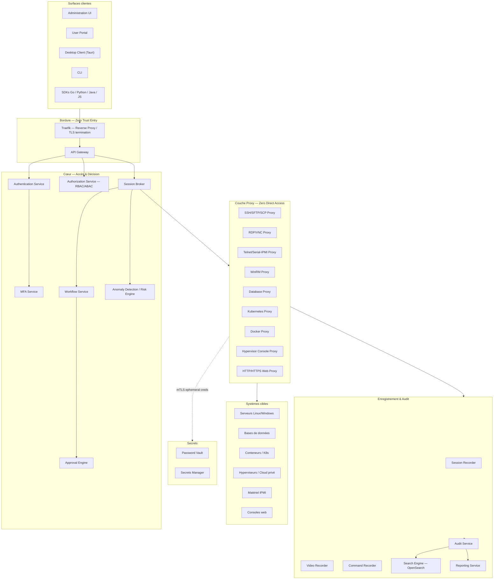
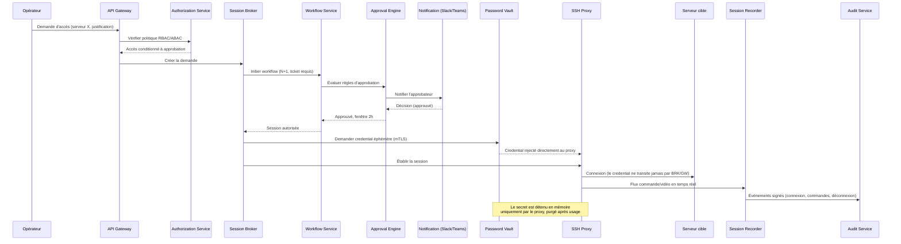

# OpenBastion — Architecture Globale

**Version** 0.1 · **Statut** Draft de travail · **Licence projet** Apache 2.0
**Portée du document** Fondation architecturale précédant tout code. Ce document est le référentiel n°1 d'une séquence de livrables (voir §16).

---

## 1. Résumé exécutif

OpenBastion est une plateforme open source de **Privileged Access Management (PAM)** cloud-native. Elle centralise, proxifie, enregistre et audite tous les accès à privilèges vers des systèmes cibles hétérogènes (serveurs, bases de données, conteneurs, hyperviseurs, matériel IPMI, consoles web), sans jamais exposer de secret en clair à un opérateur humain.

L'architecture retenue est un ensemble d'environ 35 microservices Go, organisés en 9 domaines fonctionnels, communiquant en interne via gRPC/mTLS et un bus événementiel double (NATS + Kafka), exposant une API REST/gRPC publique, et livrée sous forme de conteneurs déployables aussi bien on-premise (Docker Compose, K3s) qu'en cloud managé (Kubernetes, OpenShift).

## 2. Principes fondateurs

| Principe | Traduction architecturale |
|---|---|
| **Zero Standing Privilege** | Aucun compte cible ne possède de credential statique connu d'un humain ; les identifiants sont éphémères, générés/rotés à la demande. |
| **No Direct Access** | Aucun client ne dialogue jamais directement avec un système cible : tout passe par un proxy protocolaire OpenBastion. |
| **Full Auditability** | Chaque action (auth, session, commande, rotation, workflow, admin) génère un événement signé et immuable. |
| **Cloud-Native Portability** | Images OCI, stateless où possible, configuration 12-factor, déploiement identique on-prem/cloud. |
| **API-First** | Toute fonctionnalité de l'UI est d'abord un contrat OpenAPI/gRPC ; l'UI est un client comme un autre. |
| **Zero-Trust Internal Networking** | mTLS systématique inter-services, autorisation par service (SPIFFE-like identity), aucune confiance implicite liée au réseau. |

## 3. Vue d'ensemble en couches

Neuf domaines fonctionnels structurent le système : **Périmètre & Accès**, **Couche Proxy**, **Coffre-fort & Secrets**, **Enregistrement & Audit**, **Gouvernance (workflow/approbation/notification)**, **Sécurité & Intelligence**, **Fédération d'identité**, **Plateforme & Intégration**, **Surfaces clientes**.

## 4. Catalogue des microservices

### 4.1 Périmètre et accès

| Service | Responsabilité |
|---|---|
| **API Gateway** | Point d'entrée unique HTTP/gRPC, routage, rate-limiting, validation de schéma, injection de contexte d'identité. |
| **Authentication Service** | Authentifie l'opérateur (mot de passe + MFA, ou fédération externe), émet des jetons JWT courte durée. |
| **Authorization Service** | Point de décision RBAC/ABAC ; évalue chaque requête d'accès contre les politiques (rôle, attribut, contexte, risque). |
| **Session Broker** | Orchestrateur central : reçoit une demande d'accès autorisée, déclenche le workflow si requis, sélectionne le proxy protocolaire, demande un credential éphémère au Vault, câble le client au proxy. |

### 4.2 Couche proxy — six familles de systèmes cibles

| Famille de cible | Protocoles couverts | Microservice proxy |
|---|---|---|
| Serveurs (Linux/Windows) | SSH, SFTP, SCP | **SSH/SFTP/SCP Proxy** |
| Serveurs (Windows/Linux, bureau distant) | RDP, VNC | **RDP/VNC Proxy** |
| Serveurs (legacy) + accès matériel série | Telnet, console série IPMI (SOL) | **Telnet/Serial-IPMI Proxy** |
| Serveurs Windows (administration) | WinRM | **WinRM Proxy** |
| Bases de données | Protocoles fil (PostgreSQL, MySQL, MSSQL, Oracle, MongoDB…) | **Database Proxy** |
| Conteneurs / orchestration | Kubernetes exec, port-forward, API server | **Kubernetes Proxy** |
| Conteneurs / orchestration | Docker exec/attach | **Docker Proxy** |
| Hyperviseurs / cloud privé | Consoles VMware, Hyper-V, Proxmox, OpenStack | **Hypervisor Console Proxy** |
| Consoles web | HTTP/HTTPS avec injection de credential côté proxy | **HTTP/HTTPS Web Proxy** |

Tous ces proxies partagent un **pipeline commun** (§6) : ils sont les seuls composants du système autorisés à détenir un secret en mémoire, de façon transitoire.

### 4.3 Coffre-fort et gestion des secrets

| Service | Responsabilité |
|---|---|
| **Password Vault** | Stocke/gère les comptes privilégiés (mots de passe, clés SSH, certificats de compte) ; rotation automatique, planifiée ou post-usage ; découverte automatique de comptes. |
| **Secrets Manager** | Secrets applicatifs génériques (API keys, tokens, secrets dynamiques à durée de vie courte) ; émission à la volée pour bases de données et cloud providers. |

### 4.4 Enregistrement, recherche et audit

| Service | Responsabilité |
|---|---|
| **Session Recorder** | Orchestration du cycle de vie d'un enregistrement (démarrage, métadonnées, chiffrement, indexation) ; agrège les flux clipboard/transfert de fichiers/impression capturés par les proxies. |
| **Video Recorder** | Capture pixel (RDP/VNC/consoles graphiques) → artefacts vidéo compressés dans MinIO, rejouables. |
| **Command Recorder** | Capture texte (SSH/Telnet/DB/K8s exec) → log structuré recherchable commande par commande. |
| **Audit Service** | Journal immuable et signé de toute action système (connexion, déconnexion, commande, upload/download, escalade, rotation, config, workflow, appel API). |
| **Search Engine** | Indexation OpenSearch — recherche plein texte, par utilisateur, serveur, commande, date, à travers sessions et audit. |
| **Reporting Service** | Rapports de conformité, exports périodiques, tableaux de bord agrégés. |

### 4.5 Gouvernance : workflow, approbation, notification

| Service | Responsabilité |
|---|---|
| **Workflow Service** | Machine à états de la demande d'accès : requête → validation → fenêtre temporelle → octroi → expiration automatique. |
| **Approval Engine** | Évalue les politiques d'approbation (validation N+1, double validation, justification obligatoire, ticket ServiceNow/Jira requis). |
| **Notification Service** | Relaye les demandes/décisions vers Slack, Teams, email, webhooks. |

### 4.6 Sécurité et intelligence

| Service | Responsabilité |
|---|---|
| **MFA Service** | TOTP, WebAuthn/FIDO2, clés de sécurité (YubiKey), Passkeys, carte à puce/PKI. |
| **Anomaly Detection / Risk Engine** | Score de risque par session (commande inhabituelle, géolocalisation, horaire, volume de transfert, usage sudo anormal) ; moteur à règles, brique ML optionnelle et détachable. |

### 4.7 Fédération d'identité

| Service | Responsabilité |
|---|---|
| **LDAP Connector** | Authentification et synchronisation annuaire LDAP/OpenLDAP générique. |
| **Active Directory Connector** | Idem, spécificités AD (groupes, Kerberos). |
| **Entra ID Connector** | Fédération Microsoft Entra ID (OIDC/SAML + Graph API pour le provisioning). |
| **OpenID Connect Connector** | Fédération OIDC/OAuth2 générique (tout IdP conforme). |
| **SAML Connector** | Fédération SAML 2.0 générique. |
| **SCIM Provisioning Service** | Provisionnement/déprovisionnement automatique des identités et groupes. |

Kerberos et RADIUS sont supportés comme protocoles secondaires d'authentification au sein de l'Authentication Service et de l'AD Connector, plutôt que comme microservices dédiés.

### 4.8 Plateforme et intégration

| Composant | Responsabilité |
|---|---|
| **REST API** | Contrat public exposé par l'API Gateway, documenté OpenAPI (livrable §16.5). |
| **gRPC Internal API** | Contrats Protobuf inter-services, transport mTLS via mesh Envoy. |
| **Message Bus (NATS + Kafka)** | Infrastructure de coordination temps réel et de streaming durable (§7). |
| **Scheduler** | Tâches planifiées : rotations, expirations de session, génération de rapports. |

### 4.9 Surfaces clientes

| Client | Rôle |
|---|---|
| **Administration UI** | Console d'administration (comptes, politiques, workflows, secrets, audit, reporting). |
| **User Portal** | Portail self-service pour les opérateurs (demande d'accès, sessions actives, historique). |
| **Desktop Client (Tauri)** | Client natif léger pour sessions RDP/SSH avec intégration OS (presse-papiers contrôlé, lecteurs). |
| **CLI** | Automatisation, intégration CI/CD, scripts d'exploitation. |
| **SDK Go / Python / Java / JavaScript** | Intégration programmatique dans des outils tiers et pipelines. |

## 5. Flux illustratif : accès SSH avec workflow d'approbation

## 6. Invariant architectural : les secrets ne traversent jamais le control plane

> **Contrainte de premier ordre.** Le Session Broker, l'API Gateway et le Workflow Service n'ont **jamais** connaissance d'un secret cible. Seuls les proxies protocolaires récupèrent un credential éphémère, directement auprès du Vault via mTLS, au moment de l'établissement de connexion. Ce credential est conservé brièvement en mémoire du proxy et purgé immédiatement après usage.

Conséquences de conception :
- Le control plane (Broker, Gateway, Workflow) ne peut pas être un vecteur de fuite de secrets, même en cas de compromission.
- Chaque proxy a un droit d'accès Vault scoping strict (un proxy ne peut demander que les types de credentials correspondant à son protocole).
- L'audit peut prouver *qu'un* credential a été utilisé, sans jamais l'avoir vu transiter par un composant loggé de bout en bout.

## 7. Le double bus : NATS + Kafka

| Bus | Usage | Justification |
|---|---|---|
| **NATS** | Coordination temps réel inter-services (établissement de session, notifications d'approbation, signalement de risque) | Faible latence, sémantique pub/sub légère, adaptée aux interactions synchrones courtes. |
| **Kafka** | Streaming durable des événements d'audit et des flux d'enregistrement de session | Rétention longue durée, rejouabilité, garanties d'ordre et de durabilité requises pour la conformité. |

🔖 **Sujet ADR à venir** : ce choix a un coût opérationnel réel (deux systèmes de messagerie à exploiter) mais répond à une séparation fonctionnelle claire — coordination éphémère vs. vérité d'audit durable — jugée preferable à un compromis unique. À documenter formellement en ADR (§16.3).

## 8. Modèle de déploiement et portabilité cloud-native

- **Empaquetage** : chaque microservice = image OCI, configuration 12-factor (variables d'environnement, aucun état local persistant hors cache).
- **Orchestration** : Helm charts comme artefact de référence, compatibles Kubernetes, K3s et OpenShift sans fork de manifeste.
- **Développement/on-prem léger** : Docker Compose pour environnement de développement et petites installations on-premise.
- **Ingress/Edge** : Traefik en reverse proxy de bordure, Envoy comme data plane du service mesh interne.
- **Observabilité** : stack CNCF standard — Prometheus (métriques), Grafana (dashboards), Loki (logs), Tempo (traces), OpenTelemetry (instrumentation commune).
- **Identité de plateforme** : Keycloak comme IdP de référence embarqué, sans exclure une fédération externe (§4.7).

## 9. Sécurité transverse

| Domaine | Mesure |
|---|---|
| Transport | TLS partout ; mTLS obligatoire pour tout trafic inter-services. |
| Autorisation | RBAC (rôles) + ABAC (attributs contextuels : heure, IP, risque) combinés. |
| Chiffrement au repos | AES-256 pour secrets, enregistrements vidéo/commande, exports. |
| Hachage | Argon2id pour tout secret applicatif nécessitant un hash. |
| Identité de session | JWT courte durée, renouvellement via OIDC. |
| PKI | Rotation automatique des certificats internes (courte durée, réémission continue). |
| Applicatif | Protections CSRF, XSS, SSRF, et limitation des tentatives (anti brute-force) sur toutes les surfaces exposées. |

## 10. Stack technologique — vue de synthèse

| Couche | Technologies |
|---|---|
| Backend microservices | Go |
| UI Web (Admin UI, User Portal) | React, TypeScript, Vite |
| Client desktop | Tauri |
| Base de données relationnelle | PostgreSQL |
| Cache | Redis |
| Recherche | OpenSearch |
| Bus temps réel | NATS |
| Streaming durable | Kafka |
| Stockage objet | MinIO |
| Service mesh (data plane) | Envoy |
| Reverse proxy / edge | Traefik |
| Observabilité | Prometheus, Grafana, Loki, Tempo, OpenTelemetry |
| Identité | Keycloak + connecteurs fédérés |
| Déploiement | Docker, Docker Compose, Helm, Kubernetes, K3s, OpenShift |
| CI/CD | GitHub Actions, GitLab CI |

## 11. Exigences non fonctionnelles (aperçu)

Ces points seront détaillés dans les guides HA et PRA/PCA dédiés (§16) ; à ce stade, ils orientent déjà des choix structurants :
- **Haute disponibilité** : tous les microservices sont conçus stateless-first, état externalisé (PostgreSQL, Redis, MinIO), permettant réplication horizontale.
- **Scalabilité** : la couche proxy est le composant le plus consommateur en ressources (sessions actives) — dimensionnement indépendant du reste du système.
- **Reprise d'activité** : la séparation Vault / Audit / Session store permet des stratégies de sauvegarde et de restauration différenciées selon la criticité.

## 12. Risques architecturaux identifiés

| Risque | Impact | Traitement prévu |
|---|---|---|
| Complexité opérationnelle du double bus (NATS + Kafka) | Charge d'exploitation accrue | ADR dédié, runbooks d'exploitation |
| Surface d'attaque de la couche proxy (point de détention des secrets) | Critique | Durcissement, scoping Vault strict par proxy, purge mémoire, tests de sécurité dédiés |
| Dépendance à des connecteurs d'identité tiers hétérogènes (AD, Entra ID, SAML, OIDC) | Risque d'incohérence de mapping des identités | Modèle d'identité canonique interne + SCIM comme source de vérité de provisioning |
| Volume de données d'enregistrement de session (vidéo + commande) | Coût de stockage, rétention | Politique de rétention configurable, compression, cycle de vie MinIO |

## 13. Périmètre couvert par ce document

Ce document établit le **quoi** et le **pourquoi** de l'architecture. Il ne détaille pas encore : diagrammes C4 formels, arborescence du dépôt, ADR individuels rédigés, roadmap chiffrée, contrats OpenAPI, modèle de données PostgreSQL, spécifications d'interfaces inter-services — ces éléments font l'objet des livrables suivants.

## 14. Prochaines étapes (séquence de livraison)

1. **Diagrammes C4** (contexte, conteneurs, composants) — formalisation visuelle de ce document.
2. **Arborescence complète du dépôt Git** (monorepo vs. multi-repo, structure par service).
3. **Architecture Decision Records** initiaux, dont le double bus NATS/Kafka (§7) et l'invariant secrets (§6).
4. **Feuille de route** MVP → v1.0 → v2.0.
5. **Contrats OpenAPI** pour l'API REST publique.
6. **Modèle de données PostgreSQL**.
7. **Spécifications d'interfaces inter-services** (contrats gRPC/Protobuf).

---
*Document suivant : `OpenBastion_01_Diagrammes_C4.md`*
