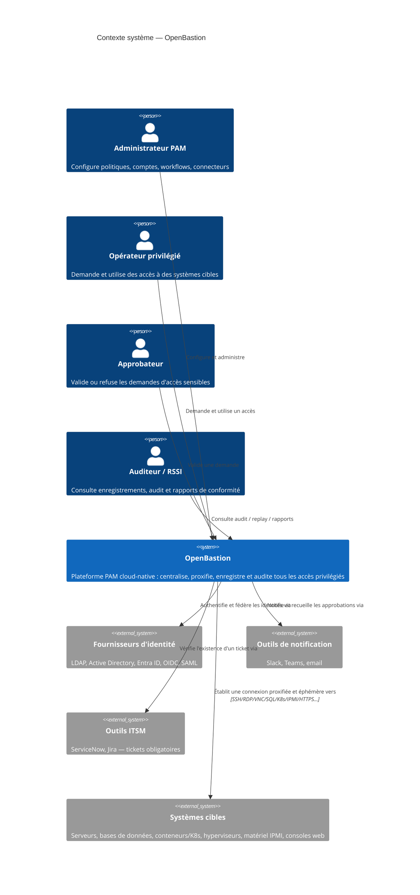
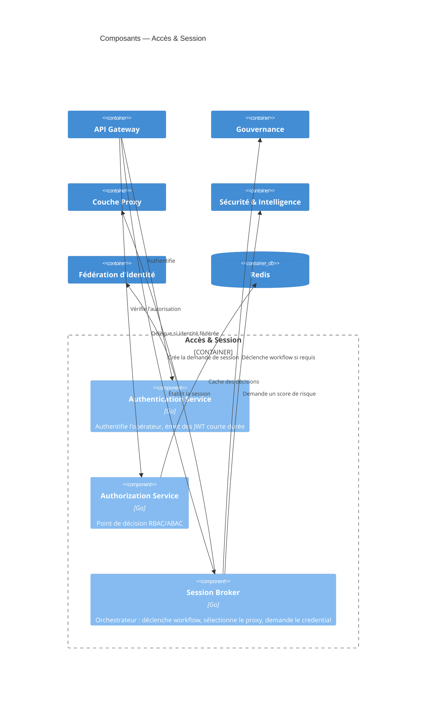
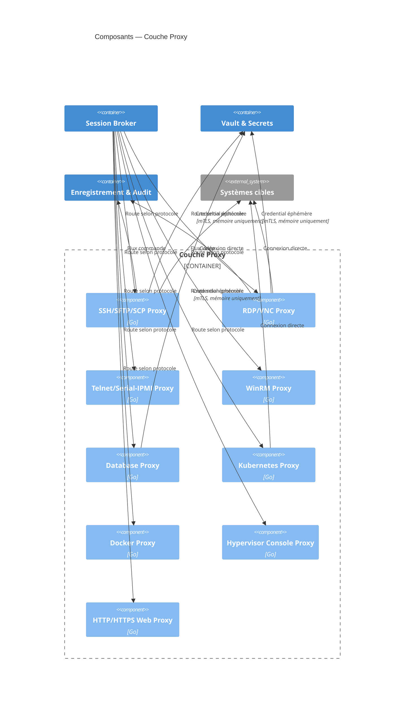
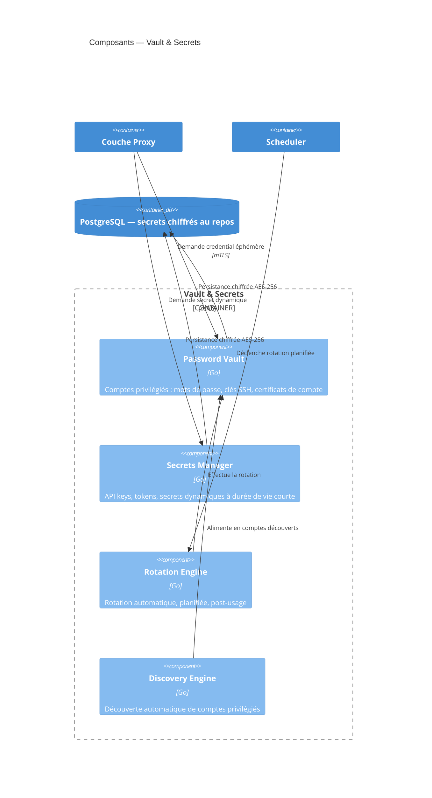
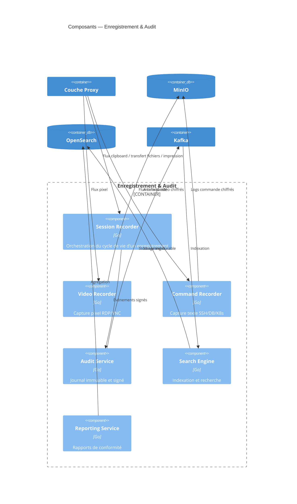
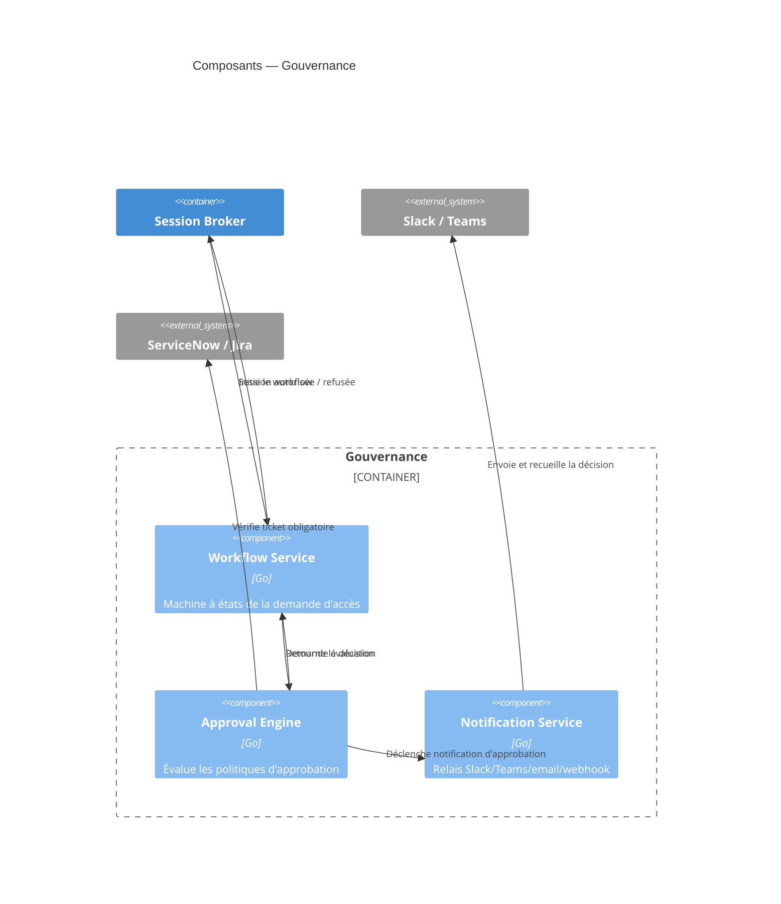

# OpenBastion — Diagrammes C4

**Version** 0.1 · **Statut** Draft de travail
**Document précédent** `OpenBastion_00_Architecture_Globale.md`
**Portée** Formalisation visuelle de l'architecture selon le modèle C4 (Simon Brown) : Contexte → Conteneurs → Composants. Le niveau 4 (Code) est volontairement exclu à ce stade, aucune ligne de code n'ayant encore été écrite.

---

## 1. Notation

| Niveau | Question à laquelle il répond | Granularité |
|---|---|---|
| **1 — Contexte** | Qui utilise OpenBastion et avec quoi interagit-il ? | Le système comme boîte noire |
| **2 — Conteneurs** | De quels grands blocs déployables OpenBastion est-il composé ? | Applications, services, magasins de données |
| **3 — Composants** | Comment un conteneur est-il structuré en interne ? | Microservices / modules au sein d'un conteneur |

Les diagrammes sont exprimés en Mermaid (syntaxe C4) pour rester versionnés en texte aux côtés du code (docs-as-code), conformément à la convention documentaire du projet.

---

## 2. Niveau 1 — Diagramme de contexte système

**Lecture** : OpenBastion est le seul point de passage entre les humains (opérateurs, approbateurs, administrateurs, auditeurs) et les systèmes cibles. Aucune flèche ne relie directement un acteur humain à un système cible — c'est la traduction visuelle du principe *No Direct Access*.

---

## 3. Niveau 2 — Diagramme de conteneurs

```mermaid
C4Container
    title Conteneurs — OpenBastion

    Person(operator, "Opérateur / Administrateur / Approbateur / Auditeur")

    System_Boundary(ob, "OpenBastion") {
        Container(auiu, "Administration UI", "React / TypeScript / Vite", "Console d'administration : comptes, politiques, secrets, audit, reporting")
        Container(portal, "User Portal", "React / TypeScript / Vite", "Portail self-service : demande d'accès, sessions actives, historique")
        Container(desktop, "Desktop Client", "Tauri", "Client natif pour sessions RDP/SSH avec intégration OS")
        Container(cli, "CLI", "Go", "Automatisation et intégration CI/CD")
        Container(sdk, "SDKs", "Go, Python, Java, JavaScript", "Intégration programmatique tierce")

        Container(gw, "API Gateway", "Go", "Point d'entrée unique HTTP/gRPC, routage, rate-limiting, validation")

        Container(access, "Accès & Session", "Go", "Authentification, autorisation, orchestration de session (Authn, Authz, Session Broker)")
        Container(proxy, "Couche Proxy", "Go", "9 proxies protocolaires — seuls composants détenant un secret en mémoire, transitoirement")
        Container(vault, "Vault & Secrets", "Go", "Password Vault + Secrets Manager, rotation et secrets dynamiques")
        Container(rec, "Enregistrement & Audit", "Go", "Session/Video/Command Recorder, Audit Service, Search Engine, Reporting")
        Container(gov, "Gouvernance", "Go", "Workflow Service, Approval Engine, Notification Service")
        Container(sec, "Sécurité & Intelligence", "Go", "MFA Service, Anomaly Detection / Risk Engine")
        Container(fed, "Fédération d'identité", "Go", "Connecteurs LDAP, AD, Entra ID, OIDC, SAML, SCIM")
        Container(sched, "Scheduler", "Go", "Tâches planifiées : rotations, expirations, rapports")

        ContainerDb(pg, "PostgreSQL", "Base relationnelle", "Comptes, politiques, métadonnées de session, workflows")
        ContainerDb(redis, "Redis", "Cache", "Sessions actives, verrous, rate-limiting")
        ContainerDb(search, "OpenSearch", "Moteur de recherche", "Index audit et sessions")
        ContainerDb(minio, "MinIO", "Stockage objet", "Enregistrements vidéo/commande chiffrés")
        Container(nats, "NATS", "Bus événementiel", "Coordination temps réel")
        Container(kafka, "Kafka", "Bus de streaming", "Streaming durable d'audit")
        Container(kc, "Keycloak", "IdP", "Identité de plateforme et fédération")
    }

    System_Ext(idp, "IdP externes")
    System_Ext(chat, "Slack / Teams")
    System_Ext(itsm, "ServiceNow / Jira")
    System_Ext(targets, "Systèmes cibles")

    Rel(operator, auiu, "HTTPS")
    Rel(operator, portal, "HTTPS")
    Rel(operator, desktop, "Sessions RDP/SSH")
    Rel(operator, cli, "CLI")

    Rel(auiu, gw, "REST/gRPC", "mTLS")
    Rel(portal, gw, "REST/gRPC", "mTLS")
    Rel(desktop, gw, "REST/gRPC", "mTLS")
    Rel(cli, gw, "REST/gRPC", "mTLS")
    Rel(sdk, gw, "REST/gRPC", "mTLS")

    Rel(gw, access, "gRPC", "mTLS")
    Rel(access, gov, "gRPC", "mTLS")
    Rel(access, proxy, "gRPC", "mTLS")
    Rel(access, sec, "gRPC", "mTLS")
    Rel(proxy, vault, "gRPC — récupération credential éphémère", "mTLS")
    Rel(proxy, rec, "Flux session", "mTLS")
    Rel(rec, search, "Indexation")
    Rel(rec, minio, "Stockage artefacts")
    Rel(gov, chat, "Webhooks")
    Rel(gov, itsm, "API")
    Rel(fed, idp, "LDAP/OIDC/SAML")
    Rel(proxy, targets, "SSH/RDP/VNC/SQL/K8s/IPMI/HTTPS")

    Rel(access, pg, "SQL")
    Rel(vault, pg, "SQL")
    Rel(gov, pg, "SQL")
    Rel(access, redis, "Cache session")
    Rel(access, nats, "Pub/Sub")
    Rel(rec, kafka, "Streaming audit")
    Rel(access, kc, "OIDC")
```

### Table de correspondance conteneurs → technologie

| Conteneur | Nature | Technologie |
|---|---|---|
| Administration UI, User Portal | Application web | React / TypeScript / Vite |
| Desktop Client | Application native | Tauri |
| CLI | Binaire | Go |
| SDKs | Bibliothèques | Go, Python, Java, JavaScript |
| API Gateway | Service | Go, Envoy (data plane) |
| Accès & Session, Proxy Layer, Vault & Secrets, Enregistrement & Audit, Gouvernance, Sécurité & Intelligence, Fédération d'identité, Scheduler | Groupes de microservices | Go |
| PostgreSQL, Redis, OpenSearch, MinIO | Magasins de données | — |
| NATS, Kafka | Bus de messages | — |
| Keycloak | Identity Provider | — |

Chaque conteneur backend listé ci-dessus regroupe plusieurs microservices détaillés au niveau 3.

---

## 4. Niveau 3 — Diagrammes de composants

### 4.1 Conteneur « Accès & Session »

### 4.2 Conteneur « Couche Proxy »

**Note d'implémentation** : les neuf proxies partagent un pipeline commun (négociation, injection de credential, capture, purge mémoire) implémenté comme bibliothèque interne partagée plutôt que dupliqué — détail qui sera traité dans les ADR et les spécifications d'interfaces inter-services.

### 4.3 Conteneur « Vault & Secrets »

### 4.4 Conteneur « Enregistrement & Audit »

### 4.5 Conteneur « Gouvernance »

### 4.6 Conteneurs « Sécurité & Intelligence » et « Fédération d'identité » — synthèse

Ces deux conteneurs sont volontairement présentés sous forme de table plutôt qu'en diagramme, leur structure interne étant peu ramifiée à ce stade :

| Conteneur | Composant | Rôle |
|---|---|---|
| Sécurité & Intelligence | MFA Service | TOTP, WebAuthn/FIDO2, YubiKey, Passkeys, carte à puce/PKI |
| Sécurité & Intelligence | Anomaly Detection / Risk Engine | Score de risque par règles, brique ML optionnelle |
| Fédération d'identité | LDAP Connector | Auth/synchro LDAP/OpenLDAP |
| Fédération d'identité | Active Directory Connector | Auth/synchro AD, Kerberos |
| Fédération d'identité | Entra ID Connector | OIDC/SAML + Graph API |
| Fédération d'identité | OpenID Connect Connector | OIDC/OAuth2 générique |
| Fédération d'identité | SAML Connector | SAML 2.0 générique |
| Fédération d'identité | SCIM Provisioning Service | Provisioning/déprovisioning automatique |

---

## 5. Traçabilité — conteneurs ↔ catalogue de microservices

| Conteneur (Niveau 2) | Microservices correspondants (doc 00, §4) |
|---|---|
| Accès & Session | API Gateway*, Authentication Service, Authorization Service, Session Broker |
| Couche Proxy | 9 proxies protocolaires (§4.2) |
| Vault & Secrets | Password Vault, Secrets Manager |
| Enregistrement & Audit | Session/Video/Command Recorder, Audit Service, Search Engine, Reporting Service |
| Gouvernance | Workflow Service, Approval Engine, Notification Service |
| Sécurité & Intelligence | MFA Service, Anomaly Detection / Risk Engine |
| Fédération d'identité | LDAP, AD, Entra ID, OIDC, SAML Connectors, SCIM Provisioning Service |
| Scheduler | Scheduler |

*L'API Gateway est représenté comme conteneur autonome au niveau 2 (point d'entrée), regroupé ici pour la traçabilité.

---

## 6. Prochaine étape

Le document suivant détaille l'**arborescence complète du dépôt Git** (organisation monorepo, structure par microservice, conventions de nommage des packages Go et des modules frontend).

---
*Document suivant : `OpenBastion_02_Arborescence_Depot.md`*
