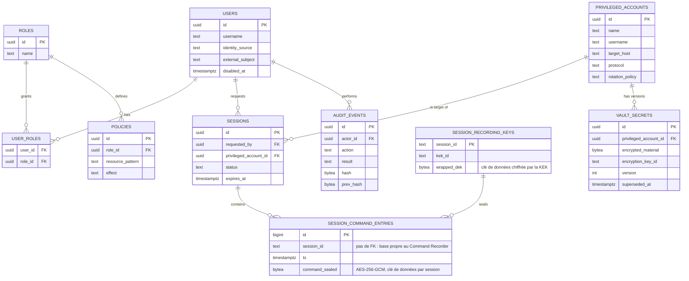

# OpenBastion — Modèle de données PostgreSQL

**Version** 0.1 · **Statut** Draft de travail
**Document précédent** `OpenBastion_05_OpenAPI.md`
**Portée** Schéma relationnel correspondant au périmètre MVP (`OpenBastion_04_Roadmap.md`, §2) et aux ressources exposées par `OpenBastion_05_OpenAPI.md`. Chaque microservice reste propriétaire de son propre schéma (aucune table n'est partagée en écriture entre services) — ce document couvre les tables portées par **Authentication/Authorization**, **Session Broker**, **Password Vault** et **Audit Service**.

---

## 1. Principes de modélisation

| Principe | Traduction |
|---|---|
| Aucun secret en clair | `vault_secrets.encrypted_material` est un blob chiffré (enveloppe AES-256) ; la clé n'est jamais stockée en base, seule une référence à un KMS/HSM externe l'est (`encryption_key_id`). |
| Audit inviolable | `audit_events` est chaîné par hash (`prev_hash` → `hash`), à la manière d'un registre append-only : toute altération rétroactive d'un événement casse la chaîne et devient détectable. |
| Séparation stockage / index | PostgreSQL est la source de vérité des métadonnées. Les objets volumineux (vidéo, v1.0) vivent dans MinIO ; l'index de recherche plein texte (OpenSearch, v1.0) est une projection dérivée, reconstructible depuis PostgreSQL — jamais l'inverse. |
| Un schéma par service | Pas de jointure inter-services au niveau base ; toute composition de données entre domaines passe par l'API/gRPC, jamais par une requête SQL cross-schéma. |

## 2. Diagramme entité-relation (périmètre MVP)



## 3. DDL — schéma MVP

```sql
CREATE EXTENSION IF NOT EXISTS pgcrypto;

-- Identité et RBAC (Authentication / Authorization Service) -----------------

CREATE TABLE users (
    id                UUID PRIMARY KEY DEFAULT gen_random_uuid(),
    username          TEXT NOT NULL UNIQUE,
    display_name      TEXT NOT NULL,
    identity_source   TEXT NOT NULL CHECK (identity_source IN ('local','oidc')),
    external_subject  TEXT,                    -- sub OIDC ; NULL si identity_source = 'local'
    password_hash     TEXT,                    -- Argon2id ; NULL si identity_source = 'oidc'
    created_at        TIMESTAMPTZ NOT NULL DEFAULT now(),
    updated_at        TIMESTAMPTZ NOT NULL DEFAULT now(),
    disabled_at       TIMESTAMPTZ,
    UNIQUE (identity_source, external_subject)
);

CREATE TABLE roles (
    id           UUID PRIMARY KEY DEFAULT gen_random_uuid(),
    name         TEXT NOT NULL UNIQUE,
    description  TEXT
);

CREATE TABLE user_roles (
    user_id     UUID NOT NULL REFERENCES users(id) ON DELETE CASCADE,
    role_id     UUID NOT NULL REFERENCES roles(id) ON DELETE CASCADE,
    granted_at  TIMESTAMPTZ NOT NULL DEFAULT now(),
    PRIMARY KEY (user_id, role_id)
);

CREATE TABLE policies (
    id                UUID PRIMARY KEY DEFAULT gen_random_uuid(),
    name              TEXT NOT NULL,
    role_id           UUID NOT NULL REFERENCES roles(id) ON DELETE CASCADE,
    resource_pattern  TEXT NOT NULL,             -- ex. 'vault:account:prod-*'
    effect            TEXT NOT NULL CHECK (effect IN ('allow','deny')),
    created_by        UUID REFERENCES users(id),
    created_at        TIMESTAMPTZ NOT NULL DEFAULT now(),
    UNIQUE (role_id, resource_pattern, effect)
);

-- Coffre-fort (Password Vault) -----------------------------------------------

CREATE TABLE privileged_accounts (
    id               UUID PRIMARY KEY DEFAULT gen_random_uuid(),
    name             TEXT NOT NULL,
    username         TEXT NOT NULL,   -- nom du compte sur la cible ; distinct de `name`, qui identifie l'enregistrement
    target_host      TEXT NOT NULL,
    protocol         TEXT NOT NULL CHECK (protocol IN ('ssh')),   -- énumération étendue en v1.0/v2.0
    rotation_policy  TEXT NOT NULL DEFAULT 'post_use'
                       CHECK (rotation_policy IN ('manual','post_use','scheduled')),
    last_rotated_at  TIMESTAMPTZ,
    created_by       UUID REFERENCES users(id),
    created_at       TIMESTAMPTZ NOT NULL DEFAULT now(),
    disabled_at      TIMESTAMPTZ,
    UNIQUE (target_host, name)
);

CREATE TABLE vault_secrets (
    id                     UUID PRIMARY KEY DEFAULT gen_random_uuid(),
    privileged_account_id  UUID NOT NULL REFERENCES privileged_accounts(id) ON DELETE CASCADE,
    encrypted_material     BYTEA NOT NULL,       -- enveloppe AES-256 ; jamais en clair
    encryption_key_id      TEXT NOT NULL,        -- référence à la clé KMS/HSM, pas la clé elle-même
    version                INT NOT NULL,
    created_at             TIMESTAMPTZ NOT NULL DEFAULT now(),
    superseded_at          TIMESTAMPTZ,          -- NULL = version courante
    UNIQUE (privileged_account_id, version)
);
CREATE INDEX idx_vault_secrets_current
    ON vault_secrets (privileged_account_id) WHERE superseded_at IS NULL;

-- Sessions (Session Broker + Command Recorder) -------------------------------

CREATE TABLE sessions (
    id                       UUID PRIMARY KEY DEFAULT gen_random_uuid(),
    requested_by             UUID NOT NULL REFERENCES users(id),
    privileged_account_id    UUID NOT NULL REFERENCES privileged_accounts(id),
    protocol                 TEXT NOT NULL,
    status                   TEXT NOT NULL
                                CHECK (status IN ('pending_approval','active','expired','terminated','denied')),
    justification             TEXT NOT NULL,
    break_glass               BOOLEAN NOT NULL DEFAULT FALSE,  -- ADR-0009 : autorisée à s'exécuter sans recorder
    connection_ticket_hash    TEXT,              -- hash du ticket émis ; jamais le ticket en clair
    created_at                TIMESTAMPTZ NOT NULL DEFAULT now(),
    expires_at                TIMESTAMPTZ NOT NULL,
    terminated_at              TIMESTAMPTZ
);
CREATE INDEX idx_sessions_requested_by ON sessions (requested_by);
CREATE INDEX idx_sessions_status ON sessions (status) WHERE status IN ('pending_approval','active');

-- Command Recorder — implémenté : services/recording-audit/command-recorder/migrations.
-- Écarts assumés par rapport à la première version de ce DDL :
--   * pas de clé étrangère vers `sessions` (une base par service) — supprimer une session
--     ne détruit donc plus son enregistrement, qui est une preuve ;
--   * `session_id` est du TEXT, comme les identifiants du Session Broker ;
--   * aucune commande n'est stockée en clair : chaque ligne est scellée en AES-256-GCM
--     sous une clé de données (DEK) propre à la session ; la DEK n'existe en base que
--     chiffrée par la KEK (KMS_KEY_HEX aujourd'hui, un KMS/HSM à terme).
CREATE TABLE session_recording_keys (
    session_id   TEXT PRIMARY KEY,
    kek_id       TEXT NOT NULL,        -- quelle KEK a chiffré cette DEK (rotation future)
    wrapped_dek  BYTEA NOT NULL,       -- nonce || DEK chiffrée ; AAD = kek_id + session_id
    created_at   TIMESTAMPTZ NOT NULL DEFAULT now()
);
CREATE TABLE session_command_entries (
    id              BIGSERIAL PRIMARY KEY,
    session_id      TEXT NOT NULL,
    ts              TIMESTAMPTZ NOT NULL,   -- précision microseconde, liée à la ligne (AAD)
    command_sealed  BYTEA NOT NULL          -- nonce || chiffré ; AAD = session_id + ts
);
CREATE INDEX idx_session_command_entries_session ON session_command_entries (session_id, ts, id);

-- Audit (Audit Service) ------------------------------------------------------

CREATE TABLE audit_events (
    id             UUID NOT NULL DEFAULT gen_random_uuid(),
    ts             TIMESTAMPTZ NOT NULL DEFAULT now(),
    actor_id       UUID REFERENCES users(id),     -- NULL pour une action système (ex. Scheduler)
    action         TEXT NOT NULL,                  -- ex. 'session.connect', 'vault.rotate'
    resource_type  TEXT NOT NULL,
    resource_id    TEXT NOT NULL,
    result         TEXT NOT NULL CHECK (result IN ('success','failure')),
    signature      BYTEA NOT NULL,                 -- signature de l'événement par le service émetteur
    prev_hash      BYTEA NOT NULL,                 -- hash de l'événement précédent de la chaîne
    hash           BYTEA NOT NULL,                 -- hash de cet événement (inclut prev_hash)
    PRIMARY KEY (id, ts)
) PARTITION BY RANGE (ts);

CREATE INDEX idx_audit_events_actor ON audit_events (actor_id, ts DESC);
CREATE INDEX idx_audit_events_action ON audit_events (action, ts DESC);
CREATE INDEX idx_audit_events_resource ON audit_events (resource_type, resource_id, ts DESC);

-- Exemple de partition mensuelle, créée à l'avance par le Scheduler
CREATE TABLE audit_events_2026_08 PARTITION OF audit_events
    FOR VALUES FROM ('2026-08-01') TO ('2026-09-01');

-- Support d'idempotence (API Gateway / Session Broker) -----------------------

CREATE TABLE idempotency_keys (
    key                TEXT PRIMARY KEY,
    endpoint           TEXT NOT NULL,
    response_snapshot  JSONB,
    created_at         TIMESTAMPTZ NOT NULL DEFAULT now()
);
```

## 4. Rationale des choix clés

| Choix | Pourquoi |
|---|---|
| `vault_secrets` versionné plutôt qu'un champ mutable sur `privileged_accounts` | Conserve l'historique de rotation (obligatoire pour l'audit) tout en gardant une requête O(1) de la version courante via l'index partiel `idx_vault_secrets_current`. |
| `audit_events` partitionné par mois | Le volume d'audit croît en continu et sans purge (Full Auditability) ; le partitionnement garde les index performants et simplifie une politique de rétention/archivage par partition entière plutôt que par ligne. |
| Chaînage `prev_hash` → `hash` | Rend une falsification rétroactive détectable sans dépendre uniquement des permissions applicatives — défense en profondeur sur l'invariant d'audit. |
| `connection_ticket_hash` et non le ticket lui-même | Le Session Broker ne doit pouvoir vérifier qu'un ticket a été émis, jamais le rejouer — cohérent avec ADR-0003. |
| Clé étrangère `actor_id` nullable sur `audit_events` | Les actions systèmes (rotation planifiée par le Scheduler, expiration automatique) doivent être auditées même sans acteur humain. |

## 5. Extensions prévues (v1.0, hors périmètre de ce document)

Ces tables seront détaillées dans une révision ultérieure de ce document, au moment de leur implémentation — elles sont esquissées ici pour anticiper les clés étrangères et éviter une migration douloureuse :

| Table (v1.0) | Service propriétaire | Objet |
|---|---|---|
| `workflow_requests`, `approvals` | Workflow Service / Approval Engine | Étapes de validation N+1, référence de ticket externe |
| `notification_log` | Notification Service | Traçabilité des envois Slack/Teams/email |
| `mfa_factors` | MFA Service | Facteurs enrôlés par utilisateur (TOTP, WebAuthn, PKI) |
| `identity_provider_configs` | Connecteurs de fédération | Configuration LDAP/AD/Entra ID/SAML |
| `secrets_manager_dynamic` | Secrets Manager | Secrets applicatifs à durée de vie courte, distincts de `vault_secrets` (ADR-0005) |
| `video_recordings` | Video Recorder | Pointeur vers l'objet MinIO (clé, taille, checksum), pas le flux lui-même |

## 6. Prochaine étape

Le document suivant — dernier de la séquence initiale — spécifie les **interfaces inter-services** : contrats gRPC/Protobuf pour les échanges internes (Session Broker ↔ Proxy, Proxy ↔ Vault, Recorder ↔ Audit), en cohérence avec les tables et l'invariant posés ici.

---
*Document suivant : `OpenBastion_07_Interfaces_Inter_Services.md`*
