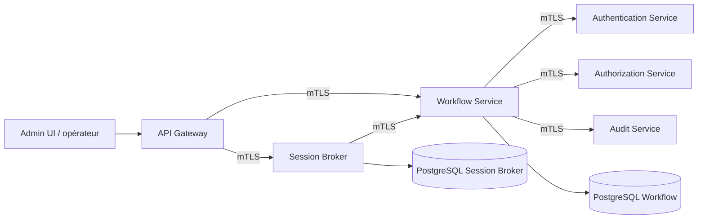
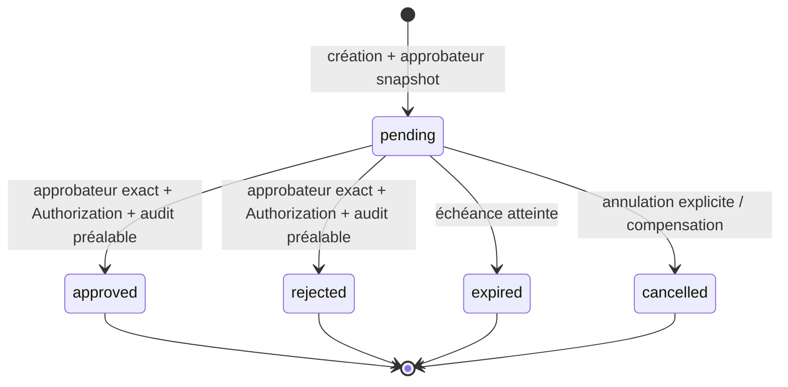
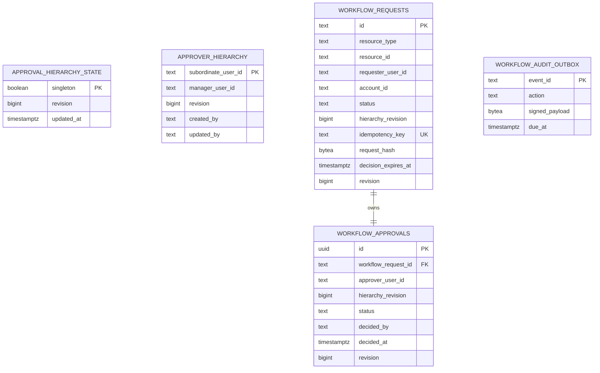

# Contrats Workflow / Approval — ADR-0138

**Statut** : contrats validés par le propriétaire (2026-11-24), base de l'implémentation incrémentale. Les écarts constatés sont corrigés dans le document avant le code correspondant.

## 1. Périmètre et responsabilités

Ce premier incrément implémente uniquement la hiérarchie N+1 et son usage pour l'approbation d'une session. Il ne constitue pas encore un moteur de workflow générique multi-étapes.

| Composant | Autorité et responsabilité |
|---|---|
| API Gateway | Authentifie le porteur, construit le `RequestContext` depuis le JWT vérifié, vérifie les permissions d'administration, applique le budget d'écriture et relaie les routes publiques. |
| Workflow Service | Seul propriétaire de la hiérarchie, de sa révision, de l'affectation d'approbateur et de l'état de décision. Résout le supérieur direct et conserve l'instantané. |
| Authentication Service | Source de vérité pour l'existence et l'état actif des identités humaines via `UserDirectory.GetAuthorizationContext`. Aucune FK SQL inter-service. |
| Authorization Service | Décide séparément `approval-hierarchy:read`, `approval-hierarchy:manage` et `session-approve:account:{accountId}`. La hiérarchie ne crée aucun droit. |
| Session Broker | Reste propriétaire du cycle de vie de la session, de la fenêtre d'approbation et du plafond commun de demandes en attente. Il persiste une outbox de dispatch dans la même transaction que la session, demande la création d'approbation et applique de façon idempotente la décision Workflow à sa session. |
| Audit Service | Reçoit les événements signés. Une indisponibilité lors de l'événement préalable interdit toute mutation ou décision. |



Le navigateur ne contacte jamais Workflow Service. Workflow Service ne reçoit et ne retourne aucun credential cible. Les identifiants d'utilisateur sont des références opaques ; les profils d'identité restent dans Authentication Service.

### Compatibilité avec ADR-0067

ADR-0138 remplace uniquement la résolution implicite de l'approbateur ordinaire : le supérieur N+1 OpenBastion devient le candidat obligatoire, mais il doit toujours être un approbateur explicitement autorisé par `session-approve:account:{accountId}`. Le reste d'ADR-0067 demeure : `approvalRequired` reste un réglage du compte, le ticket reste obligatoire et vérifié au format `APPROVAL_TICKET_PATTERN` (sans validation ITSM), les routes publiques `approve`/`reject` restent inchangées, la durée court à partir de l'approbation, et la demande reste `pending_approval` jusqu'à décision. Le même `BREAKGLASS_APPROVAL_WINDOW_MINUTES` et le même `BREAKGLASS_MAX_PENDING_PER_REQUESTER` continuent de s'appliquer ; le Broker les applique à toutes les demandes en attente (ordinaires et break-glass) dans un seul plafond atomique par demandeur. Le break-glass conserve intégralement son approbateur distinct et sa politique `breakglass-approve:account:{id}` : il n'est pas converti en N+1.

Le Workflow Service dédié rouvre l'alternative « nouveau service » écartée par ADR-0067 parce que la hiérarchie gouvernée par OpenBastion et l'instantané d'approbateur ajoutent une responsabilité persistante séparée. Il ne livre toutefois pas le moteur multi-étapes général, les délégations ou les quorums.

## 2. Contrat REST public — API Gateway

Préfixe commun : `/api/v1`. Tous les champs JSON publics sont en `camelCase`. L'acteur, ses rôles et son identité ne sont jamais acceptés dans le corps ou les paramètres : la Gateway les reconstruit depuis le JWT vérifié.

### 2.1 Hiérarchie

| Méthode et route | Permission Authorization | Comportement |
|---|---|---|
| `GET /approval-hierarchy?managerUserId=&page=&pageSize=` | `approval-hierarchy:read` sur `approval-hierarchy:all` | Lecture globale paginée, ou limitée aux subordonnés directs d'un manager. |
| `GET /approval-hierarchy/users/{userId}/manager` | `approval-hierarchy:read` sur `approval-hierarchy:user:{userId}` ou `approval-hierarchy:all` | Lit le supérieur direct. Répond 200 avec `manager: null` si aucune relation. |
| `GET /approval-hierarchy/users/{managerUserId}/reports` | `approval-hierarchy:read` sur `approval-hierarchy:reports:{managerUserId}` ou `approval-hierarchy:all` | Liste paginée des subordonnés directs uniquement. |
| `PUT /approval-hierarchy/users/{userId}/manager` | `approval-hierarchy:manage` sur `approval-hierarchy:user:{userId}` ou `approval-hierarchy:all` | Crée ou remplace le supérieur direct. `If-Match` obligatoire avec l'ETag de révision globale lu précédemment. |
| `DELETE /approval-hierarchy/users/{userId}/manager` | `approval-hierarchy:manage` sur `approval-hierarchy:user:{userId}` ou `approval-hierarchy:all` | Supprime la relation. `If-Match` obligatoire. Une absence de relation est un 404. |

ETag : `"hierarchy-{revision}"`. Chaque mutation effective incrémente la révision globale de façon monotone. Un `PUT` qui réaffecte au même supérieur est idempotent : 200, même révision, aucun événement `relation_changed`. Une révision absente ou périmée est refusée (400 si absente, 409 si conflit). Les réponses de lecture incluent `revision` et l'en-tête `ETag`. La lecture globale est réservée à une permission explicite sur `approval-hierarchy:all`; les permissions ciblées ne permettent pas de parcourir le graphe entier.

Corps PUT :

```json
{
  "managerUserId": "<user-id>"
}
```

Réponse 200 :

```json
{
  "userId": "<user-id>",
  "managerUserId": "<manager-user-id>",
  "revision": 42,
  "updatedAt": "2026-11-24T12:00:00Z"
}
```

Réponse GET sans relation :

```json
{
  "userId": "<user-id>",
  "manager": null,
  "revision": 42
}
```

Réponse GET reports : `{ "items": [{ "userId": "...", "updatedAt": "..." }], "page": 1, "pageSize": 20, "totalItems": 3, "revision": 42 }`. Elle ne divulgue ni les rôles, ni les groupes, ni les attributs d'annuaire.

Règles de validation : les deux identités doivent exister et être actives selon Authentication Service ; le subordonné et le supérieur doivent être distincts ; une seule relation par subordonné ; aucun cycle ; le client ne fournit jamais l'approbateur d'une demande de session. Les erreurs de dépendance sont 503 et n'entraînent aucune mutation.

### 2.2 Sessions et approbation

Les routes existantes sont conservées pour compatibilité :

- `GET /sessions?status=pending_approval&page=&pageSize=` retourne uniquement les demandes que l'utilisateur courant peut décider maintenant. Workflow filtre sur l'approbateur instantané et Authorization ; le Broker fusionne ces demandes avec le break-glass qu'il conserve. Si une outbox de dispatch reste en attente ou si une dépendance muette empêche de constituer la page complète, la réponse est 503, jamais une page partielle. Le Broker audite `session.listed` pour chaque demande de la page finale avant réponse.
- `POST /sessions/{sessionId}/approve` et `/reject` gardent leurs routes et réponses Session. Le Broker délègue la décision au Workflow Service ; aucun champ `decidedBy`, `approverUserId` ou rôle n'est accepté du client.
- Une approbation N+1 exige que l'acteur soit exactement l'approbateur instantané et qu'Authorization autorise aussi `session-approve` sur le compte. Le demandeur ne peut jamais décider sa demande.
- Le demandeur ne reçoit pas l'identifiant du supérieur dans la représentation Session. L'approbateur est présenté uniquement à la personne autorisée à consulter la demande. Le premier contrat ne fournit pas de recherche globale d'identités : l'administrateur doit disposer des identifiants d'utilisateurs depuis une source d'administration déjà autorisée ; un sélecteur de personnes nécessitera un contrat Authentication dédié. Le ticket obligatoire et son format, le réglage `approvalRequired`, la fenêtre de décision et le plafond commun par demandeur restent ceux d'ADR-0067/ADR-0013 ; cette proposition ne les remplace pas.

Pour une session dont le compte impose l'approbation, l'absence de supérieur actif ou l'absence d'autorisation du supérieur fait refuser la demande (session `denied`) avant toute possibilité de connexion. Aucun fallback n'est autorisé.

## 3. Contrat interne Workflow Service — HTTP/JSON sous mTLS

Les noms des champs internes reprennent les noms Protobuf en `snake_case`. `RequestContext` est reconstruit côté serveur à partir de l'identité mTLS et, pour un acteur humain, du JWT validé par la Gateway. `actor_user_id` est vide pour les tâches système. L'identité mTLS détermine l'appelant ; aucun champ `calling_service_id` fourni par le corps n'est fiable.

### 3.1 Routes appelables

| Route interne | Appelant mTLS autorisé | Objet |
|---|---|---|
| `GET /internal/v1/approval-hierarchy/users/{user_id}/manager` | `api-gateway` | Lire la relation et sa révision. |
| `GET /internal/v1/approval-hierarchy/users/{manager_user_id}/reports` | `api-gateway` | Lecture paginée des subordonnés directs. |
| `PUT /internal/v1/approval-hierarchy/users/{user_id}/manager` | `api-gateway` | Créer/remplacer la relation après audit préalable. |
| `DELETE /internal/v1/approval-hierarchy/users/{user_id}/manager` | `api-gateway` | Supprimer la relation après audit préalable. |
| `POST /internal/v1/approval-requests` | `session-broker` | Créer idempotemment une demande et figer l'approbateur N+1. |
| `GET /internal/v1/approval-requests?actor_user_id=&actor_roles=&page=&page_size=` | `session-broker` | Lister les demandes que l'acteur vérifié peut décider ; Workflow relit ses rôles dans Authentication. |
| `POST /internal/v1/approval-requests/{request_id}/approve` | `session-broker` | Décision positive idempotente. |
| `POST /internal/v1/approval-requests/{request_id}/reject` | `session-broker` | Décision négative idempotente. |
| `POST /internal/v1/approval-requests/{request_id}/cancel` | `session-broker` | Annuler lors de l'échec compensatoire ou de l'annulation de session. |

Toute autre identité mTLS est refusée, y compris l'Admin UI, les proxies, le Vault et les outils d'exploitation. Les routes inconnues sont refusées. La Gateway n'appelle jamais directement PostgreSQL.

Le Workflow Service récupère l'état et les rôles actuels via Authentication Service : `GET /auth/v1/internal/users/{user_id}/authorization-context`, appelé par le seul certificat mTLS `workflow-service`. La réponse `{user_id, exists, active, roles}` ne contient aucun nom, profil, attribut d'annuaire ni secret. `active` est dérivé de `disabled_at IS NULL` ; `roles` contient les rôles actuellement possédés et est vide si l'identité est absente ou désactivée. Workflow utilise ces rôles pour construire le `RequestContext` de `Authorization.CheckAccess`. Le Workflow Service relit ce contexte lors de la création, de la liste et de la décision ; un rôle de JWT périmé ne suffit pas. Le modèle canonique `docs/architecture/data-architecture.md` prévoit `disabled_at` ; la migration Authentication 010 et l'entité `domain.User` l'exposent maintenant. Les utilisateurs existants restent actifs (`NULL`). Les erreurs de dépendance sont 503 et n'entraînent aucune mutation. Le certificat `workflow-service` doit être ajouté à la liste des appelants autorisés d'Authorization ; aucun appel direct à la base Authentication ou Authorization n'est permis.

### 3.2 Messages JSON internes

Création (requête Broker, après persistance durable de la session et de son outbox) :

```json
{
  "context": { "trace_id": "...", "actor_user_id": "" },
  "request_id": "<session-id>",
  "resource_type": "session",
  "resource_id": "<session-id>",
  "requester_user_id": "<verified-user-id>",
  "account_id": "<privileged-account-id>",
  "ticket_reference": "INC-12345",
  "decision_expires_at": "2026-11-24T14:00:00Z",
  "idempotency_key": "session:<session-id>"
}
```

`CreateApprovalRequest` est un appel système du worker Broker : `context.actor_user_id` est vide et `requester_user_id` est recopié depuis la session durable créée à partir du JWT vérifié par la Gateway. Il ne provient jamais du navigateur ni d'un paramètre de dispatch modifiable. Workflow revalide l'existence et l'état actif du demandeur via Authentication. `request_id` est stable et identique à l'identifiant de session pour que la reprise d'un appel soit idempotente. `request_hash` porte l'empreinte SHA-256 des champs immuables reçus (`resource_type`, `resource_id`, `requester_user_id`, `account_id`, `ticket_reference`, `decision_expires_at`) ; le supérieur et la révision hiérarchique ne sont pas dans cette empreinte. Même clé et même empreinte : retour de la demande existante avec son approbateur snapshot, même si la hiérarchie a changé depuis ; même clé avec contenu différent : 409.

La réponse contient `request_id`, `status`, `approver_user_id`, `hierarchy_revision`, `created_at`, `decision_expires_at` et `revision`. L'identifiant de l'approbateur n'est transmis qu'au Broker et à l'acteur autorisé ; il n'est pas ajouté à la réponse publique du demandeur.

Décision : `{ "context": { ... }, "request_id": "...", "reason": "..." }`. L'acteur effectif est `context.actor_user_id`, jamais un champ du corps. `reason` est facultatif pour le rejet dans ce premier incrément ; aucune justification initiale ni ticket n'est réécrit lors d'une décision.

Liste : pagination `page`/`page_size` bornée à 100. Le filtre d'approbateur est toujours `context.actor_user_id`, jamais un paramètre client. Le service vérifie chaque autorisation requise ; si une dépendance échoue, il renvoie une erreur globale et aucune page partielle. Le Session Broker fusionne cette page avec les demandes break-glass qu'il conserve, trie le résultat combiné par échéance croissante puis identifiant, applique la pagination publique et journalise `session.listed` pour chaque session de la page finale avant de répondre à la Gateway, conformément à ADR-0023. Une panne de l'une des sources interdit toute réponse partielle.

### 3.3 Codes d'erreur internes

| HTTP | Sens |
|---|---|
| 400 | JSON mal formé, champ obligatoire absent ou format invalide |
| 401 | contexte humain absent/invalide sur une opération qui l'exige |
| 403 | acteur non autorisé, demande de sa propre session ou acteur différent de l'approbateur instantané |
| 404 | relation ou demande inexistante |
| 409 | cycle, révision obsolète, idempotency key réutilisée avec un contenu différent, état déjà décidé par une décision concurrente différente |
| 429 | budget de l'action dépassé à la Gateway ; le Workflow Service ne contourne pas ce budget |
| 503 | Authentication, Authorization, Audit ou PostgreSQL indisponible ; aucun effet métier accepté |

## 4. Machine à états et cohérence inter-services



`approved`, `rejected`, `expired` et `cancelled` sont terminaux. Une décision est un compare-and-swap sur `status = 'pending'` et `revision = expected_revision`. Un seul décideur gagne. La répétition exacte de la même décision par le même acteur renvoie le résultat déjà acquis ; une décision opposée ou par un autre acteur renvoie 409/403 selon le cas.

Séquence de création — outbox Broker, sans transaction distribuée : (1) le Broker valide le ticket `APPROVAL_TICKET_PATTERN`, écrit `session.approval_requested` avant mutation, puis crée la session `pending_approval` et une ligne `session_workflow_outbox` dans **la même transaction** que `SaveIfUnderPendingLimit` ; (2) le plafond `BREAKGLASS_MAX_PENDING_PER_REQUESTER` et la fenêtre `BREAKGLASS_APPROVAL_WINDOW_MINUTES` existants s'appliquent aux approbations ordinaires et break-glass ensemble, par demandeur, avec le verrou consultatif déjà utilisé par le Broker ; (3) un worker Broker livre l'outbox à `CreateApprovalRequest`, avec `request_id=session_id` et une clé d'idempotence stable ; Workflow valide demandeur et supérieur via `UserDirectory`, résout la relation, vérifie l'éligibilité Authorization, écrit l'événement préalable `workflow.approval_request_authorized`, puis enregistre la demande et son approbateur snapshot ; (4) le Broker supprime l'outbox après succès. Un crash après création Workflow mais avant suppression de l'outbox est sûr : la reprise du même appel renvoie la demande existante. Une panne transitoire conserve l'outbox et la session reste `pending_approval` — elle ne peut pas être connectée ni approuvée tant que l'affectation n'existe pas. Un refus permanent (aucun supérieur actif/autorisé) est audité par Workflow, puis le Broker marque la session `denied` et retire l'outbox ; si l'audit de refus est indisponible, il conserve l'outbox et réessaie. La session n'est jamais `active` sans décision Workflow. L'expiration ou l'annulation côté Broker demande également l'annulation idempotente du workflow.

Séquence de décision : Gateway vérifie le budget et transmet l'identité vérifiée au Broker ; Broker lit la demande Workflow pour obtenir sa `revision`, puis demande la décision avec `expected_revision` (jamais fourni par le client) ; Workflow relit l'état actif et les rôles courants de l'acteur, vérifie l'approbateur exact, Authorization, l'échéance et l'audit préalable, puis fait le CAS ; Broker applique ensuite la décision à sa session par CAS. Si le Broker échoue après la décision Workflow, une répétition identique retourne la décision existante et permet au Broker de terminer l'application. La connexion reste refusée tant que le Broker n'a pas enregistré `active`.

Une modification de hiérarchie ne touche jamais les demandes existantes : l'approbateur et la révision sont figés à la création. Toute réaffectation future devra être explicite, autorisée, auditée et spécifiée par un contrat distinct.

## 5. Modèle PostgreSQL proposé — propriété Workflow Service

Aucune FK vers `users`, `sessions` ou `privileged_accounts` : ces données appartiennent à d'autres services. Les références sont validées par appels mTLS aux propriétaires. Les identifiants sont du `TEXT` pour conserver la compatibilité des identifiants inter-services existants.

### Outbox de dispatch côté Session Broker

La session et cette ligne sont écrites dans la même transaction que le plafond de demandes en attente (`SaveIfUnderPendingLimit`). La ligne ne contient aucun secret ni justification : le worker relit les métadonnées de session par son identifiant.

```sql
CREATE TABLE session_workflow_outbox (
    session_id TEXT PRIMARY KEY REFERENCES sessions(id) ON DELETE RESTRICT,
    attempts INTEGER NOT NULL DEFAULT 0 CHECK (attempts >= 0),
    due_at TIMESTAMPTZ NOT NULL DEFAULT now(),
    lease_until TIMESTAMPTZ,
    lease_token UUID,
    last_error_code TEXT NOT NULL DEFAULT '',
    created_at TIMESTAMPTZ NOT NULL DEFAULT now(),
    CHECK ((lease_until IS NULL) = (lease_token IS NULL))
);
CREATE INDEX session_workflow_outbox_due_idx
    ON session_workflow_outbox (due_at, session_id);
```

Le worker revendique les lignes avec `FOR UPDATE SKIP LOCKED`, pose un bail (`lease_until`, `lease_token`) dans une transaction courte, puis appelle Workflow hors transaction SQL. Avant chaque appel, il relit la session et vérifie que le statut vaut `pending_approval` et que `expires_at` est dans le futur ; une session terminale ou échue ne peut pas être dispatchée. Il supprime la ligne seulement après succès ou refus terminal audité ; une erreur transitoire incrémente `attempts`, fixe `due_at` avec un backoff borné et libère le bail. Un bail expiré est récupérable après crash. Une réponse inconnue se rejoue avec la même clé ; le Workflow Service retourne la demande déjà créée. Une fois la date limite atteinte, le Broker expire la session et annule la demande Workflow ; aucun dispatch en retard ne peut réactiver une session terminale.



```sql
CREATE TABLE approval_hierarchy_state (
    singleton BOOLEAN PRIMARY KEY DEFAULT TRUE CHECK (singleton),
    revision BIGINT NOT NULL DEFAULT 0 CHECK (revision >= 0),
    updated_at TIMESTAMPTZ NOT NULL DEFAULT now()
);
INSERT INTO approval_hierarchy_state (singleton, revision)
VALUES (TRUE, 0) ON CONFLICT (singleton) DO NOTHING;

CREATE TABLE approver_hierarchy (
    subordinate_user_id TEXT PRIMARY KEY,
    manager_user_id TEXT NOT NULL,
    revision BIGINT NOT NULL CHECK (revision > 0),
    created_by TEXT NOT NULL,
    updated_by TEXT NOT NULL,
    created_at TIMESTAMPTZ NOT NULL DEFAULT now(),
    updated_at TIMESTAMPTZ NOT NULL DEFAULT now(),
    CHECK (subordinate_user_id <> manager_user_id)
);
CREATE INDEX approver_hierarchy_manager_idx
    ON approver_hierarchy (manager_user_id, subordinate_user_id);

CREATE TABLE workflow_requests (
    id TEXT PRIMARY KEY, -- identifiant stable fourni par le Broker (session id)
    resource_type TEXT NOT NULL CHECK (resource_type = 'session'),
    resource_id TEXT NOT NULL,
    requester_user_id TEXT NOT NULL,
    account_id TEXT NOT NULL,
    ticket_reference TEXT NOT NULL DEFAULT '',
    status TEXT NOT NULL CHECK (status IN ('pending','approved','rejected','expired','cancelled')),
    hierarchy_revision BIGINT NOT NULL CHECK (hierarchy_revision > 0),
    idempotency_key TEXT NOT NULL UNIQUE,
    request_hash BYTEA NOT NULL CHECK (octet_length(request_hash) = 32),
    decision_expires_at TIMESTAMPTZ NOT NULL,
    created_at TIMESTAMPTZ NOT NULL DEFAULT now(),
    decided_at TIMESTAMPTZ,
    decided_by TEXT,
    decision_reason TEXT NOT NULL DEFAULT '',
    revision BIGINT NOT NULL DEFAULT 1 CHECK (revision > 0),
    UNIQUE (resource_type, resource_id),
    CHECK ((status IN ('approved','rejected') AND decided_at IS NOT NULL AND decided_by IS NOT NULL) OR (status NOT IN ('approved','rejected') AND decided_at IS NULL AND decided_by IS NULL))
);
CREATE INDEX workflow_requests_pending_expiry_idx
    ON workflow_requests (decision_expires_at, id) WHERE status = 'pending';
CREATE TABLE workflow_approvals (
    id UUID PRIMARY KEY DEFAULT gen_random_uuid(),
    workflow_request_id TEXT NOT NULL UNIQUE REFERENCES workflow_requests(id) ON DELETE RESTRICT,
    step_number SMALLINT NOT NULL DEFAULT 1 CHECK (step_number = 1),
    approver_user_id TEXT NOT NULL,
    hierarchy_revision BIGINT NOT NULL CHECK (hierarchy_revision > 0),
    status TEXT NOT NULL CHECK (status IN ('pending','approved','rejected','expired','cancelled')),
    decided_by TEXT,
    decided_at TIMESTAMPTZ,
    decision_reason TEXT NOT NULL DEFAULT '',
    revision BIGINT NOT NULL DEFAULT 1 CHECK (revision > 0),
    created_at TIMESTAMPTZ NOT NULL DEFAULT now(),
    CHECK ((status IN ('approved','rejected') AND decided_at IS NOT NULL AND decided_by IS NOT NULL) OR (status NOT IN ('approved','rejected') AND decided_at IS NULL AND decided_by IS NULL))
);
CREATE INDEX workflow_approvals_approver_pending_idx
    ON workflow_approvals (approver_user_id, created_at, id) WHERE status = 'pending';

CREATE TABLE workflow_audit_outbox (
    event_id TEXT PRIMARY KEY,
    action TEXT NOT NULL,
    resource_type TEXT NOT NULL,
    resource_id TEXT NOT NULL,
    success BOOLEAN NOT NULL,
    actor_id TEXT NOT NULL,
    details JSONB NOT NULL DEFAULT '{}'::jsonb,
    attempts INTEGER NOT NULL DEFAULT 0 CHECK (attempts >= 0),
    due_at TIMESTAMPTZ NOT NULL DEFAULT now(),
    lease_until TIMESTAMPTZ,
    lease_token UUID,
    created_at TIMESTAMPTZ NOT NULL DEFAULT now(),
    CHECK ((lease_until IS NULL) = (lease_token IS NULL))
);
CREATE INDEX workflow_audit_outbox_due_idx ON workflow_audit_outbox (due_at, event_id);
```

L'intégrité anti-cycle est vérifiée sous un verrou consultatif transactionnel global avant insertion/remplacement : les écritures concurrentes de hiérarchie sont sérialisées ; la transaction parcourt les supérieurs successifs du manager candidat et refuse si elle atteint le subordonné. Après contrôle de la révision et du cycle, le verrou reste tenu pendant l'événement Audit préalable puis la mutation ; un échec Audit annule la transaction et libère le verrou. La mise à jour de `approval_hierarchy_state.revision` et la mutation relationnelle sont dans la même transaction. Le verrou global privilégie la correction à la contention ; un découpage du verrou n'est autorisé qu'avec une preuve qu'il conserve l'absence de cycles entre sous-graphes.

L'expiration est un CAS (`pending` → `expired`) exécuté par un worker du Workflow Service ; la liste et les décisions traitent également toute échéance passée comme expirée, même si le worker est en retard. Les deux lignes `workflow_requests` et `workflow_approvals` sont modifiées dans la même transaction et doivent toujours présenter le même état ; cette cohérence est un invariant testé. `workflow_audit_outbox` ne contient aucun secret ; les événements y sont signés par l'identité de service Workflow et livrés à Audit Service avec reprise idempotente. Toute transition (approbation, rejet, expiration, annulation) écrit son événement préalable avant le CAS ; si cet audit préalable échoue, la transition n'a pas lieu.

## 6. Événements d'audit

Tous les événements sont émis par Workflow Service via Audit Service, signés avec son identité de service et sans écriture directe dans la base d'audit. Métadonnées autorisées, sans contenu de justification ni secret :

| Action | Moment | `success` | Détails minimaux |
|---|---|---:|---|
| `approval_hierarchy.change_authorized` | Après Authorization et validation, avant mutation | true | `subordinate_user_id`, `manager_user_id`, `expected_revision`, `operation` |
| `approval_hierarchy.relation_changed` | Après commit, via outbox | true | `subordinate_user_id`, `manager_user_id`, `revision` |
| `approval_hierarchy.change_denied` | Refus Authorization/validation | false | `subordinate_user_id`, `reason_code` borné |
| `workflow.approver_resolved` | Après validation du supérieur, avant création | true | `request_id`, `requester_user_id`, `approver_user_id`, `hierarchy_revision` |
| `workflow.approver_resolution_failed` | Aucun supérieur actif ou autorisé | false | `request_id`, `requester_user_id`, `reason_code` |
| `workflow.approval_request_authorized` | Après validation, avant insertion idempotente | true | `request_id`, `resource_id`, `approver_user_id`, `hierarchy_revision` |
| `workflow.approval_request_denied` | Refus de création ou dépendance non disponible | false | `request_id`, `reason_code` |
| `workflow.approval_requested` | Après création de la demande, via outbox | true | `request_id`, `resource_id`, `requester_user_id`, `approver_user_id`, `hierarchy_revision`, `decision_expires_at` |
| `workflow.approval_decision_authorized` | Après contrôle d'éligibilité, avant CAS | true | `request_id`, `decision`, `approver_user_id` |
| `workflow.approval_approved` / `workflow.approval_rejected` | Après commit, via outbox | true | `request_id`, `resource_id`, `approver_user_id`, `hierarchy_revision` |
| `workflow.approval_decision_denied` | Refus d'identité, d'Authorization ou de séparation des tâches | false | `request_id`, `reason_code` |
| `workflow.approval_expired` / `workflow.approval_cancelled` | Transition terminale, via outbox | true | `request_id`, `resource_id`, `reason_code` |

Les tentatives de lecture/écriture refusées sont attribuées au principal vérifié. Les événements préalables ne signifient pas qu'une mutation a été commise ; l'événement final outbox est la preuve du commit. Si l'événement préalable ne peut être écrit, aucune mutation ni décision n'a lieu.

Le Session Broker conserve ses propres événements de session : `session.approval_requested` est écrit avant l'insertion de la session et de `session_workflow_outbox` ; `session.approval_request_failed` est écrit avant le passage à `denied` lorsqu'une résolution permanente échoue ; `session.listed` est écrit avant chaque demande de la page publique finale. Le Broker n'écrit jamais directement dans la base Audit.

## 7. Sécurité, concurrence et vérifications exigées

- Aucun appelant ne peut choisir `approver_user_id`, `decided_by`, `requester_user_id` ou `calling_service_id` depuis le client.
- Les lectures de hiérarchie sont protégées par Authorization ; les listes d'approbations ne révèlent que les demandes que l'acteur peut décider maintenant.
- Les décisions vérifient l'identité active et ses rôles courants, l'approbateur instantané, la séparation des tâches, la permission sur le compte, l'échéance et le statut.
- Le contrôle anti-cycle et l'incrément de révision sont atomiques entre réplicas ; une révision périmée est un conflit, jamais un écrasement.
- Les appels créateurs sont idempotents ; les décisions sont rejouables uniquement pour le même acteur et le même résultat.
- Tests requis avant livraison : cycle direct/indirect, deux mutations concurrentes formant un cycle, révision obsolète, utilisateur inactif, manager absent, approbateur non autorisé, approbation propre, approbateur modifié après snapshot, décision concurrente, audit indisponible, Workflow/Authentication/Authorization indisponible, répétition idempotente, crash entre décision Workflow et CAS Broker, pagination sans fuite et contrôle CallerRules pour chaque route interne.

## 8. Hors périmètre

Double approbation, quorum, approbations parallèles, délégation/remplaçant, fenêtre horaire, SLA, règles configurables, tickets ServiceNow/Jira validés par API, notifications Slack/Teams, workflows génériques hors session et moteur ML. Ils nécessiteront des décisions et contrats complémentaires ; ils ne doivent pas être simulés par des champs inutilisés dans ce premier schéma.
